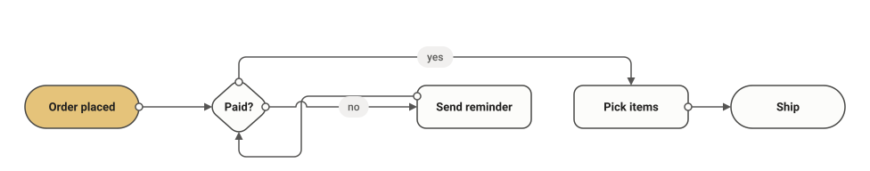

<p align="center"></p>

<p align="center"><a href="https://github.com/yjun1806/ursula-diagram/blob/main/README.md">English</a> · <b>한국어</b></p>

<p align="center"><b>코딩 에이전트가 그리는 다이어그램. Mermaid 글을 SVG와 터미널 글자 그림으로 그립니다. 브라우저도, 실행 의존성도 필요 없습니다.</b></p>

<p align="center">
  <a href="https://www.npmjs.com/package/ursula-diagram"></a>
  <a href="https://github.com/yjun1806/ursula-diagram/actions/workflows/ci.yml"></a>
  <a href="https://github.com/yjun1806/ursula-diagram/blob/main/LICENSE"></a>
</p>

<p align="center"><a href="https://yjun1806.github.io/ursula-diagram/ko/"><b>문서</b></a> · <a href="https://yjun1806.github.io/ursula-diagram/ko/playground">플레이그라운드</a> · <a href="https://yjun1806.github.io/ursula-diagram/ko/examples/">예제</a></p>

ursula는 코딩 에이전트가 쓰는 다이어그램 엔진입니다. 에이전트가 Mermaid 글 몇 줄을 쓰면 엔진이 상자·선·라벨의 자리를
계산해 SVG나 터미널 글자 그림으로 그립니다. 에이전트가 그림을 쓰고, 아무도 손으로 고쳐 주지 않고, 브라우저가 없을 수
있고, 같은 답을 터미널·채팅 창·웹에서 읽는 상황을 위해 만들었습니다. Mermaid 문서의 예시 531개(35가지 유형)를 모두
SVG와 터미널 글자 그림으로 그리며, 실행 의존성 없이 Node만으로 돕니다. ursula 스킬을 쓴 에이전트는 그림 한 장에
11–17초가 걸렸고, 모델이 배치까지 하는 스킬은 65–174초가 걸렸습니다. 그중 엔진이 그리는 시간은 0.1–0.4초이고,
나머지는 모델이 스킬을 읽고 Mermaid 글을 쓰고 답하는 시간입니다.

```
flowchart LR
  order([Order placed]) --> pay{Paid?}
  pay -->|yes| pick[Pick items]
  pay -->|no| remind[Send reminder]
  remind --> pay
  pick --> ship([Ship])
```

<p align="center"></p>

<!-- ursula-output --format text --width 80 -->
```
                                         ╭────────────╮   ╭────────────╮
                                ┌─ yes ─▶│ Pick items │──▶│    Ship    │
╭────────────╮   ╭────────────╮ │        ╰────────────╯   ╰────────────╯
│   Order    │──▶│   Paid?    │─┤
│   placed   │   ╰────────────╯ │        ╭────────────╮
╰────────────╯          ▲       └─ no ──▶│    Send    │
                        │                │  reminder  │
                        │                ╰────────────╯
                        │                       │
                        └───────────────────────┘
```

첫 블록이 입력입니다. 그 아래 그림은 `--format svg`로, 글자 그림은 `--format text --width 80`으로 ursula가 이 글을 그린
결과입니다. GitHub 코드 블록은 한글 폭을 터미널과 다르게 그리므로, 이 글자 그림은 영문으로 적었습니다.

## 설치와 사용

명령을 설치합니다(Node 22 이상, 짧은 이름 `ud`도 함께 설치됩니다).

```bash
npm install -g ursula-diagram
```

Mermaid 파일을 터미널에 80칸 폭으로 그립니다.

```bash
ursula-diagram order.mmd --format text --width 80
```

코딩 에이전트에 스킬을 설치합니다(Claude Code, Codex, Cursor 같은 에이전트).

```bash
npx skills add yjun1806/ursula-diagram
```

셸이 없는 에이전트에는 스킬 대신 MCP 서버를 등록합니다(아래는 Claude Code의 예).

```bash
claude mcp add ursula -- npx -y ursula-diagram mcp
```

## 문서

- [왜 ursula인가](https://yjun1806.github.io/ursula-diagram/ko/guide/why): 전제, 잰 값, 다른 도구가 더 맞는 경우
- [빠른 시작](https://yjun1806.github.io/ursula-diagram/ko/guide/quick-start): 설치, 첫 그림, 따르는 Mermaid 판
- [예제](https://yjun1806.github.io/ursula-diagram/ko/examples/): Mermaid 문서의 예시 531개를 SVG와 터미널 그림으로
- [플레이그라운드](https://yjun1806.github.io/ursula-diagram/ko/playground): 브라우저에서 글을 그려 보기
- [터미널에서](https://yjun1806.github.io/ursula-diagram/ko/guide/terminal): 글자 그림, 오류, 종료 코드, ASCII 출력
- [출력 형식](https://yjun1806.github.io/ursula-diagram/ko/guide/output-formats): `svg`, `text`, `text-svg`, `html`, `png`, `json`, `check`, `fixed`와 모든 옵션
- [라이브러리](https://yjun1806.github.io/ursula-diagram/ko/guide/library): `render`, `renderText`와 나머지 API
- [에이전트 스킬과 MCP](https://yjun1806.github.io/ursula-diagram/ko/guide/agent-skill): 스킬 설치, MCP 서버와 그 설정
- [색 바꾸기](https://yjun1806.github.io/ursula-diagram/ko/guide/colours): 그림의 CSS 변수
- [다른 도구와 비교](https://yjun1806.github.io/ursula-diagram/ko/guide/compared): mermaid-cli, Pele, termaid, beautiful-mermaid, mmdflux, mermaid-ascii
- [로드맵](https://yjun1806.github.io/ursula-diagram/ko/roadmap): 다음에 할 일과 그 GitHub 이슈
- [변경 내역](https://yjun1806.github.io/ursula-diagram/ko/changelog): 버전마다 바뀐 것

## 기여하기

빌드·시험·그림 비교 명령은 [개발](https://yjun1806.github.io/ursula-diagram/ko/guide/development) 페이지에 있습니다.
[`.claude/skills/ursula-dev/`](https://github.com/yjun1806/ursula-diagram/tree/main/.claude/skills/ursula-dev)의 기여자 스킬은
사람이나 에이전트에게 소스 구조와 풀 리퀘스트 절차를 안내합니다. 변경이 릴리스에 이르는 절차는
[RELEASING.md](https://github.com/yjun1806/ursula-diagram/blob/main/RELEASING.md)에 있습니다.

## 라이선스

[MIT](https://github.com/yjun1806/ursula-diagram/blob/main/LICENSE)입니다. 이 저장소에 든 Mermaid 문서 글의 고지는
[THIRD_PARTY_NOTICES.md](https://github.com/yjun1806/ursula-diagram/blob/main/THIRD_PARTY_NOTICES.md)에 있습니다.
