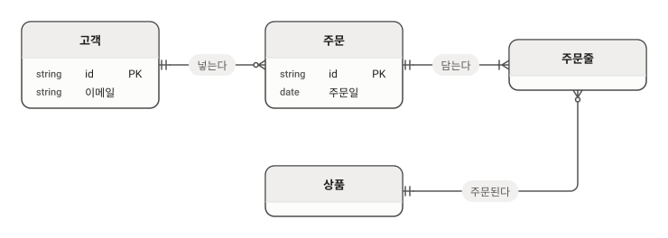

<p align="center"></p>

<p align="center"><a href="README.md">English</a> · <b>한국어</b></p>

<p align="center"><b>Mermaid 글을 SVG와 터미널 글자 그림으로 그립니다. 브라우저도, 실행 의존성도 필요 없습니다.</b></p>

<p align="center"><a href="https://yjun1806.github.io/ursula-diagram/">문서와 플레이그라운드</a> · <a href="https://yjun1806.github.io/ursula-diagram/playground">브라우저에서 해 보기</a> (영어)</p>

<p align="center">
  <a href="#왜-만들었나">왜 만들었나</a> ·
  <a href="#다른-도구와-비교">비교</a> ·
  <a href="#빠른-시작">빠른 시작</a> ·
  <a href="#그림-모음">그림 모음</a> ·
  <a href="#큰-그림">큰 그림</a> ·
  <a href="#터미널에서">터미널에서</a> ·
  <a href="#출력-형식">출력 형식</a> ·
  <a href="#라이브러리">라이브러리</a> ·
  <a href="#에이전트-스킬">에이전트 스킬</a>
</p>

ursula는 Mermaid 문서에 있는 유형 35가지의 글을 읽고, 상자·선·라벨의 자리를 직접 계산합니다. 코딩 에이전트를 위해
만들었습니다. 에이전트가 Mermaid 글 몇 줄을 쓰면 엔진이 배치를 계산해 SVG나 에이전트 터미널용 글자 그림으로 그립니다.
SVG 한 장에 드는 시간은 중앙값 0.36ms입니다. 같은 글은 언제나 같은 그림이 됩니다. Node만 있으면 돌고, 브라우저나
DOM이 필요 없으며, 실행할 때 설치할 것도 없습니다.

```
flowchart LR
  order([Order placed]) --> pay{Paid?}
  pay -->|yes| pick[Pick items]
  pay -->|no| remind[Send reminder]
  remind --> pay
  pick --> ship([Ship])
```

```
                                         ┌────────────┐   ┌────────────┐
                                ┌─ yes ─▶│ Pick items │──▶│    Ship    │
┌────────────┐   ┌────────────┐ │        └────────────┘   └────────────┘
│   Order    │──▶│   Paid?    │─┤
│   placed   │   └────────────┘ │        ┌────────────┐
└────────────┘          ▲       └─ no ──▶│    Send    │
                        │                │  reminder  │
                        │                └────────────┘
                        │                       │
                        └───────────────────────┘
```

<p align="center"></p>

첫 블록이 입력입니다. 그 아래 글자 그림과 그림은 ursula가 같은 글에서 그린 결과로, 각각 `--format text --width 80`과
`--format svg`로 그렸습니다. 이 문서의 글자 그림은 모두 영문입니다. 까닭은 [줄이 맞지 않을 때](#줄이-맞지-않을-때)에
적었습니다.

## 왜 만들었나

에이전트가 그림을 보여 주려 할 때는 대개 두 길 가운데 하나를 갑니다.

- **그림 그리기 스킬.** 모델이 배치를 직접 짜고, 좌표나 좌표를 계산하는 스크립트를 쓰고, 결과를 검사한 뒤 다시
  짭니다. 그림마다 구역·범례·강조를 골라 손으로 다듬은 듯한 그림이 나올 수 있습니다. 하지만 짜고 검사하는 한 번 한
  번이 모델의 차례 하나입니다. 그래서 그림 한 장에 차례와 토큰이 많이 들고, 같은 요청도 다음에는 다른 그림이 될 수
  있습니다.
- **Mermaid를 그대로 쓰기.** 모델이 Mermaid 글을 쓰고 Mermaid가 그립니다. 모델에게는 빠르고 싸지만, Mermaid는
  브라우저에서 그립니다(명령줄에서는 헤드리스 Chromium에서). 모델은 배치가 어떻게 나왔는지 알 수 없고, 터미널에서는 독자가 원문
  글만 봅니다.

ursula는 이 둘 사이를 메웁니다. 모델은 Mermaid 글만 쓰고 좌표는 쓰지 않습니다. 공식 예시의 글 크기는 중앙값
154바이트이고, 위의 주문 흐름도는 315바이트입니다. 배치는 모델 없이 엔진이 계산하므로 같은 글은 같은 그림이 됩니다.
엔진 하나가 SVG와 터미널 칸 단위 글자 그림을 함께 그립니다. 그래서 에이전트가 실제로 답하는 곳인 터미널에서도 그림이
보입니다.

Apple M2 Max, Node 26에서 Mermaid 문서의 예시 531장을 다섯 번씩 그려 잰 값입니다(아래 두 줄은 흐름도 한 장을 명령으로 여섯 번씩 돌린 값).

| | 중앙값 | 가장 느린 장 |
| --- | --- | --- |
| SVG, 라이브러리에서 | 0.36ms | 79.6ms |
| 터미널 글자 그림(폭 100), 라이브러리에서 | 0.29ms | 46.3ms |
| 명령 한 번, 주문 흐름도, `--format text` | 0.15초 | |
| 명령 한 번, 주문 흐름도, `--format svg` | 0.35초 | |

명령 한 번에 드는 시간은 대부분 Node를 띄우고 한 파일로 묶은 명령(1.56MB)을 읽는 시간입니다. 모델이 자기 그림을 보고
판단하는 대신 `--format check`가 꺾임·교차 수와, 때로 글에 대한 물음을 출력합니다. 에이전트 스킬은 물음에 한 번만
답하고 그립니다. 되풀이하지 않습니다.

## 다른 도구와 비교

아래 도구는 저마다 ursula가 하지 않는 일을 합니다. 표에는 잰 것만 적고, 재지 않은 칸은 「확인 안 함」으로 둡니다.
장 수는 Mermaid 문서의 예시 531장(35개 유형) 가운데 그린 수입니다.

| | 출력 | 그리는 것 | 실행 환경 | 속도 | 터미널 | 한글 같은 넓은 글자 |
| --- | --- | --- | --- | --- | --- | --- |
| **ursula** 0.1.0 | SVG, 터미널 글, 글자 그림 SVG, HTML 한 파일, JSON | 531장 중 530장, 35개 유형 모두 | Node 22 이상, 실행 의존성 0개, 브라우저 불필요 | 라이브러리에서 중앙값 1ms 미만, 명령 한 번 0.1~0.4초 | 됨: 21개 유형은 상자와 선, 14개는 표나 목록 | 터미널 칸으로 셈: 한글 시험 13장에서 끊김이 늘지 않음. 이모지는 1칸으로 셈(틀림) |
| **그림 그리기 스킬** | 모델이 쓴 SVG나 HTML | 모델이 배치할 수 있는 것, 그림마다 배치를 고름 | 에이전트의 모델 | 그림 한 장에 모델 차례 여럿(재지 않음) | 확인 안 함 | 확인 안 함 |
| **Mermaid** 브라우저 렌더(12.3.0) | SVG | 531장 중 515장(ZenUML 실패) | 브라우저, 의존성 22개 | 확인 안 함 | 확인 안 함 | 확인 안 함 |
| **mermaid-cli**(12.2.0) | SVG, PNG | Mermaid의 유형(장 수는 세지 않음) | Node 22.13 이상, Puppeteer로 띄우는 Chromium | 확인 안 함 | 안 됨 | 확인 안 함 |
| **글자 그림 도구**: mermaid-ascii, termaid, mmdflux, beautiful-mermaid | 터미널 글. mmdflux와 beautiful-mermaid는 SVG도 | mmdflux 531장 중 206장(4개 유형), beautiful-mermaid 226장(6개 유형), 나머지는 세지 않음 | Go(mermaid-ascii), Python(termaid), Rust(mmdflux), Node 라이브러리(beautiful-mermaid) | mmdflux 프로세스 한 번에 7.9ms, 나머지는 확인 안 함 | 됨 | termaid는 13장 모두 끊김이 늘지 않음. mermaid-ascii는 그린 10장에서 0, mmdflux는 그린 11장에서 1(라벨이 교차점을 덮음). 셋 다 이모지를 2칸으로 셈. beautiful-mermaid 1.1.2는 칸이 아니라 글자 수로 세어 한글 13장이 모두 어긋남 |

프로세스 단위로는 mmdflux가 `ursula-diagram` 명령보다 약 12배 빠릅니다(흐름도 예시 116장의 중앙값 7.9ms 대 99ms). 차이는
대부분 Node를 띄우는 시간입니다. 프로그램 하나 안에서 부르면 ursula도 1ms 아래입니다.

### ursula를 쓰지 않는 편이 나은 때

- **손으로 다듬은 그림이 필요할 때.** 그림 그리기 스킬이나 사람은 그림마다 구역·범례·강조를 고릅니다. ursula는 생김새가
  하나이고 색만 CSS 변수로 바꿉니다. 유형에 따라 곧은 선이 적습니다. 공식 예시에서 곧은 선의 비율은 흐름도 87%,
  C4 60%, 유스케이스 67%이고, Event Modeling은 선이 모두 꺾입니다.
- **명령줄에서 PNG가 필요할 때.** mermaid-cli가 PNG를 씁니다. ursula는 `html` 페이지에서만 PNG로 저장합니다.
- **프로세스를 장마다 새로 띄워 많이 그릴 때.** mmdflux 같은 네이티브 바이너리가 약 12배 빨리 뜹니다. Node 프로그램
  하나에서 라이브러리를 부르면 이 비용이 없습니다.
- **라벨에 이모지가 있고 터미널에 그릴 때.** ursula는 이모지를 1칸으로 세어 그 상자의 오른쪽 변이 한 칸 밀립니다.
  mermaid-ascii, mmdflux, termaid는 2칸으로 셉니다.
- **터미널에 차트를 그림으로 그리고 싶을 때.** pie, XY chart, radar, quadrant, Sankey, Wardley, timeline,
  user journey, railroad, Venn, Cynefin은 터미널에서 그림이 아니라 표나 목록으로 나옵니다.
- **subgraph가 겹쳐 있고 터미널에 그릴 때.** 안쪽 subgraph는 상자 안의 상자가 아니라 「바깥 / 안」처럼 이름을 이은 띠로
  그려져, 포함 관계가 보이지 않습니다.
- **API가 굳어 있어야 할 때.** 첫 판 0.1.0입니다. 라이브러리는 모르는 옵션을 경고 없이 무시합니다(명령은 거절합니다).

## 빠른 시작

npm으로 `ursula-diagram` 명령을 설치합니다(Node 22 이상, 짧은 별칭 `ursula`도 함께 깔립니다). 설치하지 않고 한 번만 쓰려면 `npx ursula-diagram`을 씁니다.

```bash
npm install -g ursula-diagram
npx ursula-diagram order.mmd --format text   # 설치하지 않고
```

```bash
cat > order.mmd <<'EOF'
flowchart LR
  order([Order placed]) --> pay{Paid?}
  pay -->|yes| pick[Pick items]
  pay -->|no| remind[Send reminder]
  remind --> pay
  pick --> ship([Ship])
EOF
ursula-diagram order.mmd --format text --width 80   # 위의 글자 그림
ursula-diagram order.mmd --format svg > order.svg   # 위의 그림
```


## 그림 모음

아래 그림은 모두 `ursula-diagram <파일> --format svg`가 낸 결과를 고치지 않고 실었습니다. SVG는 글자를 정한 자리에
놓으므로 한글 라벨도 그대로 씁니다.

<table>
  <tr>
    <td align="center"><b>흐름도</b><br></td>
    <td align="center"><b>시퀀스</b><br></td>
  </tr>
  <tr>
    <td align="center"><b>클래스</b><br></td>
    <td align="center"><b>상태</b><br></td>
  </tr>
  <tr>
    <td align="center"><b>ER</b><br></td>
    <td align="center"><b>C4 컨텍스트</b><br></td>
  </tr>
  <tr>
    <td align="center" colspan="2"><b>마인드맵</b><br></td>
  </tr>
  <tr>
    <td align="center" colspan="2"><b>간트</b><br></td>
  </tr>
</table>

<details>
<summary>그림마다의 Mermaid 글</summary>

```
flowchart LR
  A([시작]) --> B{올바른가?}
  B -->|예| C[저장]
  B -->|아니오| D[오류 표시]
  D --> A
  C --> E([끝])
```

```
sequenceDiagram
  actor U as 사용자
  participant W as 웹
  participant A as 인증 API
  participant D as DB
  U->>W: 로그인
  W->>A: POST /login
  A->>D: 사용자 찾기
  D-->>A: 레코드
  A-->>W: 토큰
  W-->>U: 대시보드
```

```
classDiagram
  class 주문 {
    +id: string
    +합계(): number
  }
  class 주문줄 {
    +수량: number
  }
  class 상품 {
    +이름: string
  }
  class 고객 {
    +이메일: string
  }
  고객 "1" --> "*" 주문
  주문 *-- "1..*" 주문줄
  주문줄 --> 상품
```

```
stateDiagram-v2
  [*] --> 초안
  초안 --> 검토: 제출
  검토 --> 초안: 수정 요청
  검토 --> 게시: 승인
  게시 --> 보관: 내림
  보관 --> [*]
```

```
erDiagram
  고객 ||--o{ 주문 : 넣는다
  주문 ||--|{ 주문줄 : 담는다
  상품 ||--o{ 주문줄 : "주문된다"
  고객 {
    string id PK
    string 이메일
  }
  주문 {
    string id PK
    date 주문일
  }
```

```
C4Context
  Person(buyer, "구매자", "물건을 산다")
  System(store, "웹 상점", "주문을 받는다")
  System_Ext(pay, "결제 대행", "카드를 결제한다")
  System_Ext(mail, "메일 서비스", "메일을 보낸다")
  Rel(buyer, store, "주문한다")
  Rel(store, pay, "결제를 맡긴다")
  Rel(store, mail, "영수증을 보낸다")
```

```
gantt
  title 출시
  dateFormat YYYY-MM-DD
  section 만들기
  설계   :a1, 2026-01-05, 5d
  엔진   :a2, after a1, 10d
  section 내보내기
  문서     :b1, after a2, 4d
  출시     :milestone, after b1, 0d
```

```
mindmap
  root((그림))
    흐름
      흐름도
      스윔레인
    구조
      클래스
      ER
    시간
      간트
      타임라인
```

</details>

### 그리는 유형

유형은 Mermaid와 같이 글의 첫 줄에서 읽습니다. 35가지 모두입니다.

Architecture, Block, C4, Class, Cynefin, Entity Relationship, Event Modeling, Flowchart, Gantt, Git Graph, Ishikawa,
Kanban, Mindmap, Packet, Pie, Quadrant, Radar, Railroad(IR, ABNF, EBNF, PEG), Requirement, Sankey, Sequence, State,
Swimlanes, Timeline, TreeView, Treemap, Use Case, User Journey, Venn, Wardley Map, XY Chart, ZenUML.

## 큰 그림

Mermaid 문서에 있는 C4 예시 두 장을 고치지 않고 그린 것입니다. 컨테이너 그림은 요소 10개, 관계 13개, 경계 하나로
이루어지고, 경계 밖의 사람·시스템이 경계 안의 앱들과 이어집니다. 배포 그림은 노드가 3단까지 겹치고(데이터센터, 서버,
Tomcat, 앱) 복제되는 데이터베이스로 끝납니다. 두 장 모두 교차가 없습니다(`--format check`: 꺾임 7개, 4개).

<p align="center"></p>
<p align="center"></p>

글은 [examples/c4-container.mmd](examples/c4-container.mmd)와 [examples/c4-deployment.mmd](examples/c4-deployment.mmd)에
있습니다. 터미널에서도 그려지지만, 이 크기에서는 긴 관계 라벨을 줄이고 경계를 띠로 그리므로 이런 그림은 SVG가 더
잘 읽힙니다.

## 터미널에서

`--format text`는 상자 그리기 글자로 그리고, `--width`에 맞춰 그림을 배치합니다. 맨 위의 주문 흐름도는
`--width 80`에서 왼쪽에서 오른쪽으로 놓이고, `--width 40`에서는 같은 글이 위에서 아래로 쌓입니다. 그림을 잘라 내지는
않습니다. 아래는 위 그림 모음의 시퀀스·간트·마인드맵을 영문 라벨로 바꿔 쓴 글을
`ursula-diagram <파일> --format text --width 80`으로 그린 결과입니다.

```
┌───────────────┐   ┌─────┐       ┌───────────┐     ┌─────┐
│ [actor] User  │   │ Web │       │ Auth API  │     │ DB  │
└───────────────┘   └─────┘       └───────────┘     └─────┘
        ├── Log in ───▶┆                ┆              ┆
        ┆              ├─ POST /login ─▶┆              ┆
        ┆              ┆                ├─ Find user ─▶┆
        ┆              ┆                ┆◀┄┄ Record ┄┄┄┤
        ┆              ┆◀┄┄┄┄ Token ┄┄┄┄┤              ┆
        ┆◀┄ Dashboard ┄┤                ┆              ┆

─▶ Call   ┄▶ Reply
```

```
Release
          January 2026
          5  6  7  8  9  10 11 12 13 14 15 16 17 18 19 20 21 22 23 24
──────────┬──┬──┬──┬──┬──┬──┬──┬──┬──┬──┬──┬──┬──┬──┬──┬──┬──┬──┬──
Build
  Design  ███████████████ 5d
  Engine                 ██████████████████████████████ 10d
Ship
  Docs                                                 ████████████ 4d
  Release                                                         ◆ 0d milestone
```

```
Diagrams
├── Flow
│   ├── Flowchart
│   └── Swimlanes
├── Structure
│   ├── Class
│   └── ER
└── Time
    ├── Gantt
    └── Timeline
```

몇몇 유형(pie, quadrant, radar, sankey, XY chart, timeline, user journey, railroad, Venn, Cynefin, Wardley)은
터미널에서 표나 목록으로 나옵니다. 터미널에서는 그림보다 그쪽이 더 정확하기 때문입니다.

```
pie title Pets
  "Dogs" : 386
  "Cats" : 85
  "Rats" : 15
```

```
Pets
Dogs  386  79.4%
Cats   85  17.5%
Rats   15   3.1%
```

### 줄이 맞지 않을 때

글자 그림은 모든 글자가 엔진이 센 폭대로 그려질 때만 줄이 맞습니다. 엔진은 선과 화살촉을 한 칸으로, 한글·한자·가나를
두 칸으로 셉니다. 진짜 터미널은 이렇게 그립니다. 채팅 창, 웹 페이지, 문서의 코드 블록은 그렇지 않은 경우가 많아 상자가
어긋납니다. 예를 들어 맥의 크롬에서 GitHub 코드 블록은 한글 한 글자를 영문 1.44칸 폭으로 그립니다(재 본 값, 운영체제와 글꼴에 따라 다릅니다). 이 문서의 글자 그림을 영문으로만
적은 까닭입니다.

이럴 때 쓰는 방법이 두 가지 있습니다.

- **`--format text-svg`** 는 같은 글자 그림을 SVG 한 장으로 그립니다. 선을 도형으로 그리고 모든 낱말을 칸 자리에 고정하므로,
  어떤 글꼴로 보여도 줄이 어긋나지 않습니다. 아래는 한글 라벨이 든 그림입니다.

  

- **`--charset ascii`** 는 ASCII 글자만으로 그립니다. 상자 선 글자를 두 칸으로 그리는 터미널에 씁니다.

  ```
                                           +------------+   +------------+
                                  +- yes ->| Pick items |-->|    Ship    |
  +------------+   +------------+ |        +------------+   +------------+
  |   Order    |-->|   Paid?    |-+
  |   placed   |   +------------+ |        +------------+
  +------------+          ^       +- no -->|    Send    |
                          |                |  reminder  |
                          |                +------------+
                          |                       |
                          +-----------------------+
  ```

<details>
<summary><code>--charset ascii</code>가 바꾸는 글자</summary>

| | `unicode`(기본) | `ascii` |
| --- | --- | --- |
| 선, 굵은 선, 점선 | `─ │` `━ ┃` `┄ ┆` | `- \|` `= #` `. :` |
| 모서리·갈림·교차, 둥근 모서리 | `┌ ├ ┼`, `╭ ╮ ╰ ╯` | `+`, `/ \ \ /` |
| 화살촉, 속 빈 화살촉 | `▶ ◀ ▼ ▲`, `──▷` | `> < v ^`, `--\|>` |
| 채운·빈 마름모, 점, 막대 | `◆ ◇` `● ◉` `█` | `@ o` `* @` `#` |
| 잘린 글 | `…` | `~` |

그림 안의 글은 적은 그대로 둡니다. 엔진은 표의 글자를 어디에 있든 바꾸고, 일부 터미널이 두 칸으로 그리는 기호 몇 개(`·`
`×` `—` `∩` `⊕`)도 바꿉니다.

</details>

## 출력 형식

| `--format` | 받는 것 |
| --- | --- |
| `svg`(기본) | 글 안에 바로 넣는 SVG 한 장. 색은 CSS 변수이고, 밝은·어두운 모드는 보는 쪽 설정을 따릅니다. |
| `text` | `--width`에 맞춰 배치한 상자 그리기 글자 그림. `--color`를 주지 않으면 색 코드를 넣지 않습니다. |
| `text-svg` | 터미널 글자 그림과 똑같이 생긴 SVG 한 장. 글자 그림의 줄이 어긋나는 자리에 씁니다. |
| `html` | 그림, 밝은·어두운 전환, PNG·SVG 저장이 든 파일 하나. |
| `json` | 상자·선·라벨과 그 좌표. |
| `check` | 꺾임·교차 수를 적은 한 줄과, 때로 글을 어떻게 고치면 나아지는지 묻는 물음. |

```bash
ursula-diagram flow.mmd --format svg > flow.svg
ursula-diagram flow.mmd --format text --width 100
ursula-diagram flow.mmd --format text --width 100 --charset ascii
ursula-diagram flow.mmd --format text-svg --width 100 > flow-text.svg
ursula-diagram flow.mmd --format html --theme dark --title "Flow" > flow.html
ursula-diagram flow.mmd --format check
cat flow.mmd | ursula --format json
```

파일을 주지 않으면 명령은 표준 입력에서 글을 읽습니다. `--theme auto|light|dark`는 `html` 페이지의 밝은·어두운
모드를 정하고, `auto`는 시스템 설정을 따릅니다. 모든 옵션은 `ursula-diagram --help`로 봅니다.

## 라이브러리

```ts
import { render, renderText, renderTextSvg } from 'ursula-diagram';
import { renderHtml } from 'ursula-diagram/html';

const src = `flowchart LR
  A[Start] --> B{Ok?}
  B -->|yes| C[Done]
  B -->|no| A`;

const svg = render(src);                 // SVG 문자열
const text = renderText(src, 80);        // { lines: string[] } 또는 { error: string }
const ascii = renderText(src, 80, { charset: 'ascii' });
const picture = renderTextSvg(src, 80);  // { svg: string } 또는 { error: string }
const page = renderHtml(src, { title: 'Flow' });
```

글을 그릴 수 없으면 `render`는 고칠 곳을 알려 주는 `UrsulaError`를 던집니다. `renderText`는 같은 내용을 `{ error }`로
돌려줍니다. 그림이 폭을 넘을 때도 그렇습니다. 그림을 잘라 내지 않습니다.

`renderTextSpans`는 같은 줄을 톤(`normal`, `dim`, `bold`, `accent`)이 붙은 조각으로 돌려줍니다. 터미널 글에 직접 색을
입히는 쪽에서 씁니다. `spansToSvg`는 그 조각을 `renderTextSvg`와 같은 그림으로 그리고, `toAscii`는 이미 그린 줄의 그리기
글자를 ASCII로 바꿉니다. ER 그림의 줄에는 `{ countBars: true }`를 주면 세로 선 위의 개수 막대가 `-`가 됩니다.

## 색 바꾸기

SVG 그림은 모든 색을 CSS 변수에서 읽고 기본값을 함께 싣습니다. 그래서 그림만 놓아도 제 색으로 보이고, 페이지가 변수를
정하면 그 색을 따릅니다. 변수마다 밝은 값과 어두운 값이 있고, 어두운 값은 `prefers-color-scheme: dark`에서 씁니다.

```css
:root {
  --ursula-accent: #0b6e4f;
  --ursula-start-fill: #bfe3d0;
}
```

<details>
<summary>색 변수 전체</summary>

| 변수 | 칠하는 것 | 밝은 값 | 어두운 값 |
| --- | --- | --- | --- |
| `--ursula-fg` | 이름과 본문 글자 | `#201f1e` | `#efeeec` |
| `--ursula-muted` | 둘째 줄과 라벨 | `#5b5b59` | `#b2b1af` |
| `--ursula-faint` | 뒤로 물러나는 글자와 표시 | `#878685` | `#757472` |
| `--ursula-line` | 상자 사이의 선 | `#565554` | `#a5a4a2` |
| `--ursula-border` | 상자 테두리 | `#484846` | `#bebdbb` |
| `--ursula-hair` | 구역 테두리, 구분선, 격자선 | `#e2e1e0` | `#2c2b2a` |
| `--ursula-surface` | 상자와 바탕의 면 | `#fcfcfa` | `#171614` |
| `--ursula-lane` | 칠한 띠: 레인, 구역, 머리 띠, 태그 | `#efeeed` | `#252422` |
| `--ursula-chip-fill` | 라벨 칩과 노트 | `#f1f0ef` | `#252422` |
| `--ursula-accent` | 강조 선과 글자 | `#82641c` | `#dab975` |
| `--ursula-start-fill` | 시작 상자와 가장 높은 막대의 면 | `#e5c37a` | `#dab975` |
| `--ursula-accent-tint` | 옅은 강조 면 | `#f6ecd7` | `#372c15` |
| `--ursula-on-accent` | 시작 상자 위의 글자 | `#201f1e` | `#171614` |
| `--ursula-bg` | 흐름도, 클래스, 상태, ER, 요구사항, C4, 유스케이스 그림의 배경 | `transparent` | `transparent` |
| `--ursula-panel` | 차트 뒤의 판 | `none` | `none` |
| `--ursula-bar` | 차트의 중립 막대 | `#c8c7c6` | `#434241` |
| `--ursula-tint-outer` | C4 그림의 가장 바깥 경계 | `#f4f3f1` | `#1e1d1b` |
| `--ursula-tint-inner` | C4 그림의 가장 안쪽 경계 | `#f6f5f3` | `#1c1b19` |
| `--ursula-tint-chip` | 경계 면 위의 라벨 칩 | `#ebeae8` | `#262523` |
| `--ursula-s1` … `--ursula-s8` | 차트의 계열 여덟 | | |
| `--ursula-s1-tint` … `--ursula-s8-tint` | 계열마다의 옅은 면 | | |

</details>

## 에이전트 스킬

`skills/ursula`는 코딩 에이전트용 스킬입니다. `SKILL.md`는 에이전트에게 Mermaid 글을 쓰는 법, `--format check`로
엔진에 그림을 물어보는 법, 읽는 사람에게 어떤 출력을 줄지를 알려 줍니다. `scripts/ursula.mjs`는 명령을 한 파일로 묶은
것이라, 스킬은 Node 22 이상만 있으면 돌고 아무것도 설치하지 않습니다.

[skills](https://skills.sh) 명령으로 설치합니다. Claude Code, Codex, Cursor 같은 에이전트에 함께 쓰입니다.

```bash
npx skills add yjun1806/ursula-diagram            # 이 프로젝트에
npx skills add yjun1806/ursula-diagram -g         # 모든 프로젝트에
npx skills add yjun1806/ursula-diagram -a claude-code   # 한 에이전트에만
```

`skills/ursula` 폴더를 에이전트의 스킬 폴더에 직접 복사해도 됩니다. npm 패키지에도 들어 있습니다.

```bash
cp -R "$(npm root -g)/ursula-diagram/skills/ursula" ~/.claude/skills/
```

스킬을 쓰면 에이전트는 Mermaid 글을 쓰고 `--format check`를 돌린 뒤, 독자가 있는 곳에 맞춰 출력을 고릅니다. 터미널에는
`text`, 채팅이나 웹 페이지에는 `text-svg`, 파일에는 `svg`나 `html`을 줍니다.

### 에이전트 터미널에서

에이전트의 답을 보여 주는 호스트는 스킬 없이, 모델 차례를 더 쓰지 않고 직접 그림을 그릴 수도 있습니다. 답 안의
` ```mermaid ` 블록을 찾아 그 자리에 그림을 넣으면 됩니다. 터미널에서 답을 다시 그리는 Claude Code mod가 이런 호스트의
예입니다. `renderTextSpans`는 줄마다 톤이 붙은 조각을 돌려주고, 톤마다 어떤 색을 쓸지는 호스트가 정합니다.

````ts
import { renderTextSpans } from 'ursula-diagram';

const TONE = { normal: '', dim: '\x1b[2m', bold: '\x1b[1m', accent: '\x1b[33m' };

function drawMermaidBlocks(reply: string, width: number): string {
  return reply.replace(/```mermaid\n([\s\S]*?)```/g, (block, src) => {
    const out = renderTextSpans(src, width);
    if ('error' in out) return block; // 그릴 수 없으면 글을 그대로 둔다
    return out.lines
      .map((line) => line.map((s) => TONE[s.tone] + s.text + '\x1b[0m').join(''))
      .join('\n');
  });
}
````

그림은 `width`를 넘지 않습니다. 폭 안에 들어가지 않으면 `renderTextSpans`가 `{ error }`를 돌려주고, 블록은 글로 남습니다.

## 개발

```bash
npm install
npx tsc --noEmit
npm test              # 느린 대조를 뺀 시험 전체
npm run test:rewrite  # 층 배치 엔진의 느린 대조, 15분쯤
bun scripts/build.ts  # dist/와 스킬 안의 명령. 그림이 바뀌면 다시 돌립니다
cd site && npm install && npm run dev   # 문서 사이트와 플레이그라운드. 방금 만든 dist/를 씁니다
```

빌드한 파일은 Node 22 이상에서 돕니다. 저장소를 받은 폴더에서는 Node 24 이상이 소스를 바로 실행합니다:
`node src/cli.ts order.mmd --format text`.