<p align="center">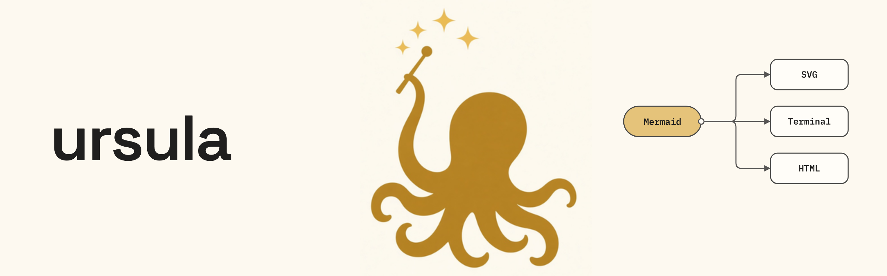</p>

<p align="center"><a href="README.md">English</a> · <b>한국어</b></p>

<p align="center"><b>코딩 에이전트가 그리는 다이어그램. Mermaid 글을 SVG와 터미널 글자 그림으로 그립니다. 브라우저도, 실행 의존성도 필요 없습니다.</b></p>

<p align="center"><a href="https://yjun1806.github.io/ursula-diagram/ko/">문서와 플레이그라운드</a> · <a href="https://yjun1806.github.io/ursula-diagram/ko/playground">브라우저에서 해 보기</a></p>

<p align="center">
  <a href="#에이전트를-위해">에이전트를 위해</a> ·
  <a href="#왜-ursula인가">왜 ursula인가</a> ·
  <a href="#다른-도구와-비교">비교</a> ·
  <a href="#빠른-시작">빠른 시작</a> ·
  <a href="#그림-모음">그림 모음</a> ·
  <a href="#큰-그림">큰 그림</a> ·
  <a href="#터미널에서">터미널에서</a> ·
  <a href="#출력-형식">출력 형식</a> ·
  <a href="#라이브러리">라이브러리</a> ·
  <a href="#에이전트-스킬">에이전트 스킬</a>
</p>

ursula는 코딩 에이전트가 쓰도록 만든 다이어그램 도구입니다. 에이전트가 Mermaid 글 몇 줄을 쓰면 엔진이 상자·선·라벨의 자리를
계산해 SVG나 터미널 글자 그림으로 그립니다. SVG 한 장은 중앙값 0.36ms에 그립니다. Mermaid 문서에 있는 35가지 유형을
모두 읽습니다. 같은 글에서는 언제나 같은 그림이 나옵니다. Node만 있으면 돌아가고 브라우저나 DOM은 필요 없으며, 실행할 때
따로 설치할 것도 없습니다.

**Mermaid 판.** 문법은 2026년 11월 12일에 공개된 Mermaid 문서(`develop` 브랜치, 커밋 `ddb4c118`)를 따릅니다. 그날
기준 Mermaid의 최신 정식판은 12.3.0, 최신 미리보기판은 13.0.0-alpha.3입니다. 그 뒤에 Mermaid에 추가된 문법은 아직 읽지
못할 수 있습니다.

```
flowchart LR
  order([Order placed]) --> pay{Paid?}
  pay -->|yes| pick[Pick items]
  pay -->|no| remind[Send reminder]
  remind --> pay
  pick --> ship([Ship])
```

```
                                         ╭────────────╮   ╭────────────╮
                                ┌─ yes ─▶│ Pick items │──▶│    Ship    │
╭────────────╮   ╭────────────╮ │        ╰────────────╯   ╰────────────╯
│   Order    │──▶│   Paid?    │─┤
│   placed   │   ╰────────────╯ │        ╭────────────╮
╰────────────╯          ▲       └─ no ──▶│    Send    │
                        │                │  reminder  │
                        │                ╰────────────╯
                        │                       │
                        └───────────────────────┘
```

<p align="center"></p>

첫 블록이 입력입니다. 그 아래 글자 그림과 SVG 그림은 ursula가 이 글로 그린 결과입니다. 글자 그림은
`--format text --width 80`으로, SVG는 `--format svg`로 그렸습니다. 이 문서의 글자 그림은 모두 영문으로 그렸고, 그 까닭은
[줄이 맞지 않을 때](#줄이-맞지-않을-때)에 적었습니다.

## 에이전트를 위해

에이전트는 그림이 나올 때까지 같은 루프를 돕니다. Mermaid를 쓰고, 그려서 점검하고, 고칠 곳을 읽고, 다시 씁니다.
ursula는 이 루프의 단계마다 에이전트가 쓰기 좋게 만들었습니다.

- **고치는 법까지 알려 주는 오류.** 오류는 틀린 줄과 칸을 `^`로 가리키고, 의도했을 법한 낱말과 맞는 예시 줄을
  함께 보여 줍니다. 에이전트는 이것을 읽고 고쳐 다시 그립니다. 일부러 틀리게 쓴 글 93개에서 틀린 줄을 오류가 준
  예시 줄로 바꾸자 93개 모두 그려졌습니다.
- **호출 한 번으로 그림과 점검 결과를 함께 받습니다.** `--check`를 주면 그림은 표준 출력으로, 점검 결과는 표준 오류로
  나옵니다. 교차하는 선은 원본의 줄 번호로 알려 줍니다([터미널에서](#터미널에서)). `--width`에 들어가지 않는 그림은
  종료 코드 3으로 끝나며 들어가는 폭을 알려 줍니다.
- **문법은 필요할 때 묻습니다.** `ursula-diagram syntax <유형>`은 그 유형의 짧은 예시와 규칙을 출력합니다.
- **MCP 서버.** 셸을 쓸 수 없는 에이전트는 `ursula-diagram mcp`가 여는 `render`, `check`, `syntax` 도구를 씁니다
  ([MCP로](#mcp로)).
- **스킬은 한 줄로 설치합니다.** `npx skills add yjun1806/ursula-diagram`([에이전트 스킬](#에이전트-스킬)).

## 왜 ursula인가

ursula는 사람이 아니라 에이전트가 그림을 쓰고, 아무도 손으로 고쳐 주지 않고, 브라우저가 없을 수 있고, 같은 답을
터미널·채팅 창·웹에서 읽는 상황을 위해 만들었습니다. 이 상황이라면 아래 네 가지가 중요합니다.

- **모델은 Mermaid만 쓰고 배치는 엔진이 계산합니다.** ursula 스킬은 그림 한 장에 12~18초, 출력 토큰 0.9k~1.7k를
  썼습니다. 모델이 배치를 정하는 스킬은 65~174초, 6.7k~18.8k를 썼습니다. ursula로 두 번 그린 SVG는 바이트까지 같았습니다.
- **오류는 어디가 틀렸는지에 더해 무엇을 쓸지 알려 줍니다.** 일부러 틀리게 쓴 글 93개에서 틀린 줄을 오류의 예시 줄로
  바꾸자 93개 모두 그려졌습니다. `--fix`는 그중 50개를 턴을 더 쓰지 않고 그립니다.
- **브라우저가 필요 없습니다.** Node만으로 돌고 실행 의존성이 0개이며, 명령 한 번에 103ms가 걸립니다. mermaid-cli는
  그림마다 Chromium을 띄워 630ms가 걸립니다.
- **엔진 하나로 어디에나 그립니다.** SVG, 터미널 글자 그림, 글자 그림을 담은 SVG, MCP를 모두 냅니다. Mermaid 문서의
  예시 531개를 SVG와 터미널 글자로 모두 그립니다.

사람이 중요한 그림 한 장을 손으로 다듬거나, 브라우저에서 Mermaid를 이미 잘 쓰고 있다면 ursula가 필요 없을 수 있습니다.
측정 조건, 두 스킬의 그림, 맞지 않는 경우는 [왜 ursula인가](https://yjun1806.github.io/ursula-diagram/ko/guide/why)
페이지에 있습니다.

## 다른 도구와 비교

여기서 비교한 도구 가운데 Mermaid 문서의 예시 531개를 SVG와 터미널 글로 모두 그리는 것은 ursula 하나입니다. 그림 한 장을
명령 한 번으로 그리면 mermaid-cli보다 약 6배 빠르고, 네이티브 글자 그림 도구보다는 약 10배 느립니다.

ursula 스킬을 쓴 에이전트는 같은 그림 세 장을 [diagram-design](https://github.com/cathrynlavery/diagram-design)보다
5~13배 빨리 그렸습니다. diagram-design은 모델이 배치를 정하고 SVG를 직접 쓰는 스킬입니다.

| 그림 | diagram-design 초 | ursula 초 | diagram-design 토큰 | ursula 토큰 |
| --- | ---: | ---: | ---: | ---: |
| flowchart, 노드 9 | 71 | 15 | 387k | 63k |
| C4, 요소 7 | 164 | 18 | 525k | 55k |
| sequence, 메시지 10 | 152 | 12 | 529k | 38k |

그림마다 스킬별로 두 번씩 그렸고, 매번 headless Claude Code 세션을 새로 띄웠습니다. 표는 두 번의 평균입니다(Claude Opus
5.5, 같은 지시문, 시험하는 스킬 하나만 설치, MCP 서버 없음). 토큰에는 Claude Code가 턴마다 다시 보내는 캐시가 들어 있습니다.

| 도구 | SVG | 터미널 | flowchart 한 장 ms | 실행 의존성 |
| --- | ---: | ---: | ---: | ---: |
| **ursula** | **531** | **531** | **103** | **0** |
| mermaid-cli 12.2.0 | 531 | — | 630 | 10 + Puppeteer |
| Pele 1.13.0 | 515 | — | 85 | 0 |
| termaid 0.14.0 | — | 366 | 69 | 0 |
| beautiful-mermaid 1.1.3 | 226 | 225 | 163 | 2 |
| mmdflux 2.6.1 | 206 | 205 | 9 | 0 |
| mermaid-ascii 1.6.2 | — | 160 | 9 | 0 |

앞의 두 열은 Mermaid 문서의 예시 531개(35개 유형) 가운데 그린 수입니다. 명령이 0으로 끝나고 무언가를 출력하면 그린 것으로
셉니다. 시간 열은 모든 도구가 그리는 flowchart 예시 103개를 그림마다 새 프로세스로 그리며 파일마다 3번 잰 중앙값입니다.
SVG를 내는 도구는 SVG를 그리는 시간을 쟀습니다.
2026-11-26, Apple M2 Max, Node 26.12.1에서 쟀습니다.

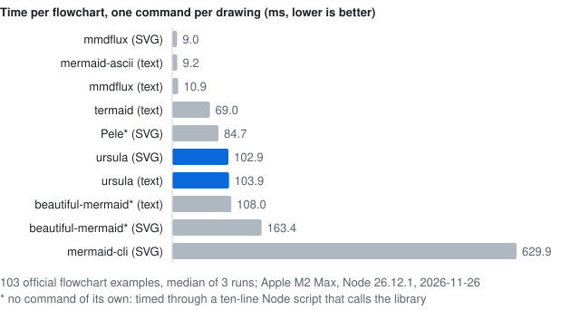

### 다른 도구가 더 맞는 경우

- **명령줄에서 PNG가 필요할 때.** mermaid-cli는 PNG를 바로 씁니다. 대신 한 장에 630ms가 걸리고 Chromium이 필요합니다.
  ursula에서는 한 파일 HTML 페이지의 버튼으로만 PNG를 저장할 수 있습니다.
- **그림마다 새 프로세스를 띄울 때.** mmdflux와 mermaid-ascii는 9~11ms가 걸립니다. ursula는 103ms가 걸리는데, 그중
  59ms는 빈 Node 스크립트를 실행해도 드는 시간입니다.
- **한 프로그램 안에서 라이브러리를 여러 번 부를 때.** flowchart 한 장을 그리는 데 Pele는 0.015ms,
  beautiful-mermaid의 글자 출력은 0.009ms로 ursula(0.6ms)보다 빠릅니다.
- **터미널로 보낼 그림의 라벨에 이모지가 있을 때.** ursula는 이모지를 한 칸으로 세기 때문에 이모지가 든 그림에서
  선 끊김이 18개 늘었습니다. mmdflux, mermaid-ascii, termaid는 늘어난 끊김이 0개였습니다.

한글, 출력 형식, 한 프로세스 안의 라이브러리 속도, 같은 예시를 나란히 그린 그림은
[비교 페이지](https://yjun1806.github.io/ursula-diagram/ko/guide/compared)에 있습니다.

## 빠른 시작

npm으로 `ursula-diagram` 명령을 설치합니다(Node 22 이상, 짧은 별칭 `ursula`도 함께 설치됩니다).

```bash
npm install -g ursula-diagram
```

설치하지 않고 한 번만 쓰려면 `npx`로 부릅니다.

```bash
npx ursula-diagram order.mmd --format text
```

위의 flowchart를 `order.mmd`에 씁니다.

```bash
cat > order.mmd <<'EOF'
flowchart LR
  order([Order placed]) --> pay{Paid?}
  pay -->|yes| pick[Pick items]
  pay -->|no| remind[Send reminder]
  remind --> pay
  pick --> ship([Ship])
EOF
```

위의 글자 그림을 80칸 폭으로 출력합니다.

```bash
ursula-diagram order.mmd --format text --width 80
```

위의 그림을 SVG로 저장합니다.

```bash
ursula-diagram order.mmd --format svg > order.svg
```


## 그림 모음

아래 그림은 모두 `ursula-diagram <파일> --format svg`가 낸 결과를 고치지 않고 실었습니다. SVG는 글자를 정해진 좌표에
놓으므로 한글 라벨도 그대로 들어갑니다.

<table>
  <tr>
    <td align="center"><b>Flowchart</b><br>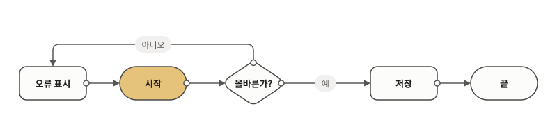</td>
    <td align="center"><b>Sequence</b><br>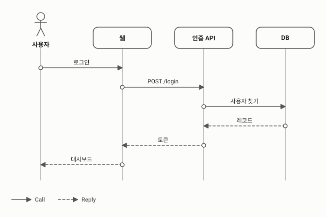</td>
  </tr>
  <tr>
    <td align="center"><b>Class</b><br>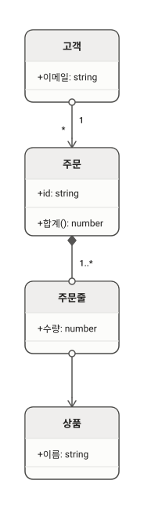</td>
    <td align="center"><b>State</b><br>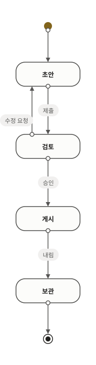</td>
  </tr>
  <tr>
    <td align="center"><b>ER</b><br></td>
    <td align="center"><b>C4 context</b><br>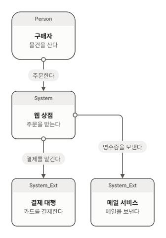</td>
  </tr>
  <tr>
    <td align="center" colspan="2"><b>Mindmap</b><br>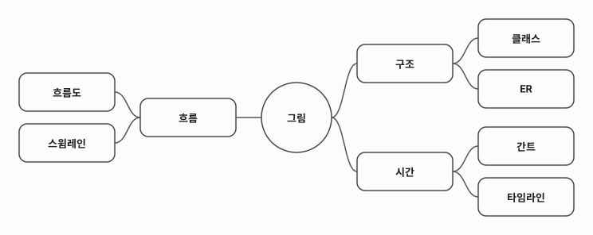</td>
  </tr>
  <tr>
    <td align="center" colspan="2"><b>Gantt</b><br>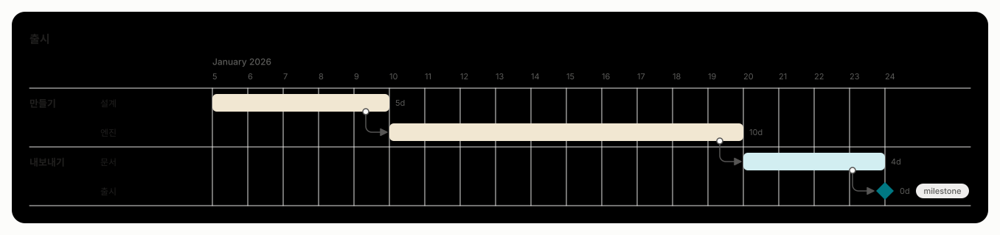</td>
  </tr>
</table>

<details>
<summary>그림별 Mermaid 글</summary>

```
flowchart LR
  A([시작]) --> B{올바른가?}
  B -->|예| C[저장]
  B -->|아니오| D[오류 표시]
  D --> A
  C --> E([끝])
```

```
sequenceDiagram
  actor U as 사용자
  participant W as 웹
  participant A as 인증 API
  participant D as DB
  U->>W: 로그인
  W->>A: POST /login
  A->>D: 사용자 찾기
  D-->>A: 레코드
  A-->>W: 토큰
  W-->>U: 대시보드
```

```
classDiagram
  class 주문 {
    +id: string
    +합계(): number
  }
  class 주문줄 {
    +수량: number
  }
  class 상품 {
    +이름: string
  }
  class 고객 {
    +이메일: string
  }
  고객 "1" --> "*" 주문
  주문 *-- "1..*" 주문줄
  주문줄 --> 상품
```

```
stateDiagram-v2
  [*] --> 초안
  초안 --> 검토: 제출
  검토 --> 초안: 수정 요청
  검토 --> 게시: 승인
  게시 --> 보관: 내림
  보관 --> [*]
```

```
erDiagram
  고객 ||--o{ 주문 : 넣는다
  주문 ||--|{ 주문줄 : 담는다
  상품 ||--o{ 주문줄 : "주문된다"
  고객 {
    string id PK
    string 이메일
  }
  주문 {
    string id PK
    date 주문일
  }
```

```
C4Context
  Person(buyer, "구매자", "물건을 산다")
  System(store, "웹 상점", "주문을 받는다")
  System_Ext(pay, "결제 대행", "카드를 결제한다")
  System_Ext(mail, "메일 서비스", "메일을 보낸다")
  Rel(buyer, store, "주문한다")
  Rel(store, pay, "결제를 맡긴다")
  Rel(store, mail, "영수증을 보낸다")
```

```
gantt
  title 출시
  dateFormat YYYY-MM-DD
  section 만들기
  설계   :a1, 2026-01-05, 5d
  엔진   :a2, after a1, 10d
  section 내보내기
  문서     :b1, after a2, 4d
  출시     :milestone, after b1, 0d
```

```
mindmap
  root((그림))
    흐름
      흐름도
      스윔레인
    구조
      클래스
      ER
    시간
      간트
      타임라인
```

</details>

### 그리는 유형

ursula는 Mermaid처럼 글의 첫 줄을 보고 유형을 정합니다. 35가지 모두 그립니다.

Architecture, Block, C4, Class, Cynefin, Entity Relationship, Event Modeling, Flowchart, Gantt, Git Graph, Ishikawa,
Kanban, Mindmap, Packet, Pie, Quadrant, Radar, Railroad(IR, ABNF, EBNF, PEG), Requirement, Sankey, Sequence, State,
Swimlanes, Timeline, TreeView, Treemap, Use Case, User Journey, Venn, Wardley Map, XY Chart, ZenUML.

## 큰 그림

아래는 Mermaid 문서에 있는 C4 예시 두 장을 고치지 않고 그린 그림입니다. container 그림은 요소 10개, 관계 13개, 경계 하나로
이루어지며, 경계 밖의 사람·시스템이 경계 안의 앱들과 이어집니다. deployment 그림은 노드가 3단까지 겹치고(데이터센터, 서버,
Tomcat, 앱) 복제되는 데이터베이스로 끝납니다. 두 장 모두 교차가 없습니다(`--format check`: 꺾임 7개, 4개).

<p align="center">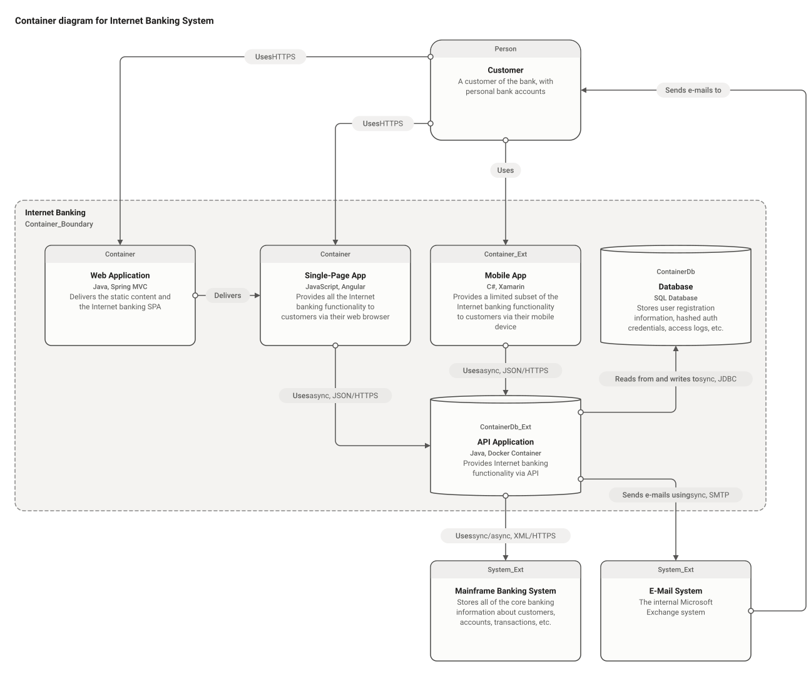</p>
<p align="center">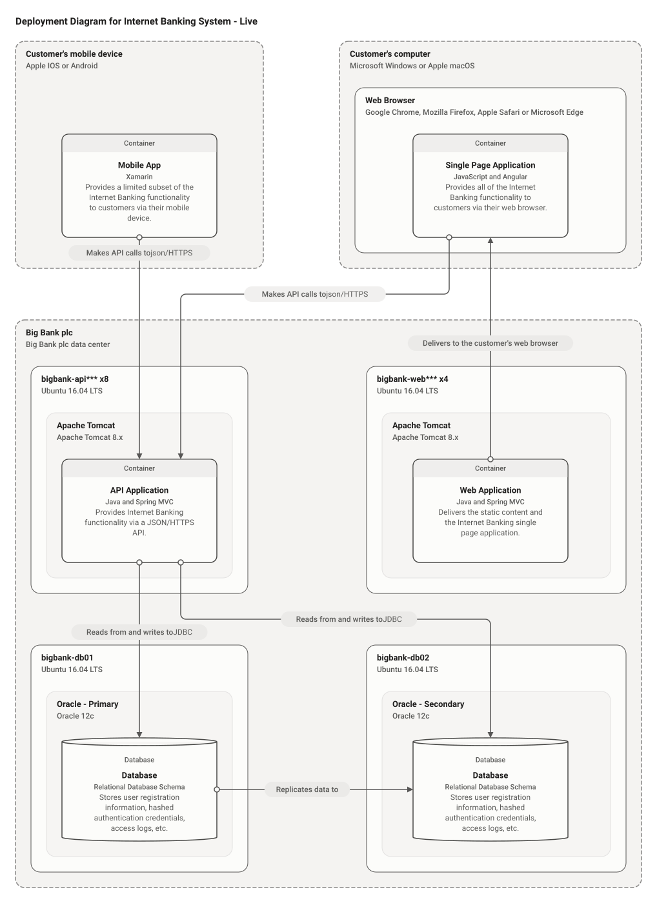</p>

글은 [examples/c4-container.mmd](examples/c4-container.mmd)와 [examples/c4-deployment.mmd](examples/c4-deployment.mmd)에
있습니다. 터미널에서도 그릴 수 있지만, 이 크기에서는 긴 관계 라벨을 줄이고 경계를 띠로 그립니다. 그래서 이런 그림은 SVG가
더 잘 읽힙니다.

## 터미널에서

`--format text`는 상자 그리기 글자로 그리고, `--width`에 맞춰 그림을 배치합니다. 맨 위의 주문 flowchart는
`--width 80`에서 왼쪽에서 오른쪽으로 놓이고, `--width 40`에서는 같은 글이 위에서 아래로 쌓입니다. 그림을 잘라 내지는
않습니다. 아래는 위 그림 모음의 sequence·Gantt·mindmap을 영문 라벨로 바꿔 쓴 글을
`ursula-diagram <파일> --format text --width 80`으로 그린 결과입니다.

```
╭───────────────╮   ╭─────╮       ╭───────────╮     ╭─────╮
│ [actor] User  │   │ Web │       │ Auth API  │     │ DB  │
╰───────────────╯   ╰─────╯       ╰───────────╯     ╰─────╯
        ├── Log in ───▶┆                ┆              ┆
        ┆              ├─ POST /login ─▶┆              ┆
        ┆              ┆                ├─ Find user ─▶┆
        ┆              ┆                ┆◀┄┄ Record ┄┄┄┤
        ┆              ┆◀┄┄┄┄ Token ┄┄┄┄┤              ┆
        ┆◀┄ Dashboard ┄┤                ┆              ┆

─▶ Call   ┄▶ Reply
```

```
Release
          January 2026
          5  6  7  8  9  10 11 12 13 14 15 16 17 18 19 20 21 22 23 24
──────────┬──┬──┬──┬──┬──┬──┬──┬──┬──┬──┬──┬──┬──┬──┬──┬──┬──┬──┬──
Build
  Design  ███████████████ 5d
  Engine                 ██████████████████████████████ 10d
Ship
  Docs                                                 ████████████ 4d
  Release                                                         ◆ 0d milestone
```

```
Diagrams
├── Flow
│   ├── Flowchart
│   └── Swimlanes
├── Structure
│   ├── Class
│   └── ER
└── Time
    ├── Gantt
    └── Timeline
```

몇몇 유형(pie, quadrant, radar, sankey, XY chart, timeline, user journey, railroad, Venn, Cynefin, Wardley)은
터미널에서 표나 목록으로 나옵니다. 터미널에서는 그림보다 표나 목록이 더 정확하기 때문입니다.

```
pie title Pets
  "Dogs" : 386
  "Cats" : 85
  "Rats" : 15
```

```
Pets
Dogs  386  79.4%
Cats   85  17.5%
Rats   15   3.1%
```

그림이 `--width`에 들어가지 않으면 명령은 그림을 내지 않고 종료 코드 3으로 끝나며, 들어가는 폭을 알려 줍니다. 그리는
형식에 `--check`를 더하면 엔진의 점검 결과가 표준 오류로 함께 나옵니다. 점검 결과에는 개수, 교차하는 선과 그 선을 적은
줄 번호, 질문이 들어 있습니다. 점검은 svg 배치를 셉니다. 터미널 그림은 선을 자기 격자에 따로 그리므로 교차가 다를 수
있습니다. `ursula-diagram syntax`는 유형 목록을, `ursula-diagram syntax <유형>`은 작은 예시와
규칙을 보여 줍니다. 오류 메시지는 줄과 열을 가리키고, 가능하면 의도했을 낱말과 바르게 쓴 예시 한 줄을 붙입니다.

```
error: line 1: expected a 'flowchart' or 'graph' header
  1 | flowchrt LR
    | ^^^^^^^^
did you mean: flowchart
example: flowchart LR
```

종료 코드는 0(그림을 그림), 1(글의 오류), 2(옵션 오류), 3(폭 부족), 4(엔진 안의 오류)입니다. 모든 옵션은
`ursula-diagram --help`로 확인합니다.

### 줄이 맞지 않을 때

글자 그림은 모든 글자가 엔진이 센 폭대로 그려질 때만 줄이 맞습니다. 엔진은 선과 화살촉을 한 칸으로, 한글·한자·가나를
두 칸으로 셉니다. 실제 터미널은 이렇게 그립니다. 채팅 창, 웹 페이지, 문서의 코드 블록은 그렇지 않은 경우가 많아 상자가
어긋납니다. 예를 들어 맥의 크롬에서 GitHub 코드 블록은 한글 한 글자를 영문 1.44칸 폭으로 그립니다(직접 잰 값이며 운영체제와 글꼴에 따라 다릅니다). 그래서 이 문서의 글자 그림은
영문으로만 적었습니다.

이럴 때는 두 가지 방법을 씁니다.

- **`--format text-svg`** 는 같은 글자 그림을 SVG 한 장으로 그립니다. 선을 도형으로 그리고 모든 낱말을 칸 자리에 고정하므로,
  어떤 글꼴로 보여도 줄이 어긋나지 않습니다. 아래는 한글 라벨이 든 그림입니다.

  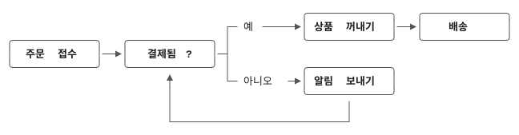

- **`--charset ascii`** 는 ASCII 글자만으로 그립니다. 상자 선 글자를 두 칸으로 그리는 터미널에서 씁니다.

  ```
                                           +------------+   +------------+
                                  +- yes ->| Pick items |-->|    Ship    |
  +------------+   +------------+ |        +------------+   +------------+
  |   Order    |-->|   Paid?    |-+
  |   placed   |   +------------+ |        +------------+
  +------------+          ^       +- no -->|    Send    |
                          |                |  reminder  |
                          |                +------------+
                          |                       |
                          +-----------------------+
  ```

<details>
<summary><code>--charset ascii</code>가 바꾸는 글자</summary>

| | `unicode`(기본) | `ascii` |
| --- | --- | --- |
| 선, 굵은 선, 점선 | `─ │` `━ ┃` `┄ ┆` | `- \|` `= #` `. :` |
| 상자·선의 모서리, 갈림, 교차 | `╭ ┌ ├ ┼` | `+` |
| git 가지·kanban 카드·block 모양의 둥근 꺾임 | `╭ ╮ ╰ ╯` | `/ \ \ /` |
| 화살촉, 속 빈 화살촉 | `▶ ◀ ▼ ▲`, `──▷` | `> < v ^`, `--\|>` |
| 채운·빈 마름모, 점, 막대 | `◆ ◇` `● ◉` `█` | `@ o` `* @` `#` |
| 잘린 글 | `…` | `~` |

그림 안의 글은 적은 그대로 둡니다. 다만 엔진은 위 표의 글자가 글 안에 있어도 바꾸고, 일부 터미널이 두 칸으로 그리는
기호 몇 개(`·` `×` `—` `∩` `⊕`)도 바꿉니다.

</details>

## 출력 형식

| `--format` | 받는 것 |
| --- | --- |
| `svg`(기본) | 문서에 바로 넣는 SVG 한 장. 색은 CSS 변수이고, 밝은·어두운 모드는 보는 사람의 설정을 따릅니다. |
| `text` | `--width`에 맞춰 배치한 상자 그리기 글자 그림. `--color`를 주지 않으면 색 코드를 넣지 않습니다. |
| `text-svg` | 터미널 글자 그림과 똑같이 생긴 SVG 한 장. 글자 그림의 줄이 어긋나는 곳에서 씁니다. |
| `html` | 그림과 밝은·어두운 전환, PNG·SVG 저장 기능을 담은 파일 하나. |
| `json` | 상자·선·라벨과 그 좌표. |
| `check` | 꺾임·교차 수를 적은 한 줄. 때로 글을 어떻게 고치면 나아지는지 묻는 질문이 붙습니다. |

SVG 파일을 만듭니다.

```bash
ursula-diagram flow.mmd --format svg > flow.svg
```

100칸 폭의 글자 그림을 출력합니다.

```bash
ursula-diagram flow.mmd --format text --width 100
```

같은 그림을 ASCII 글자만으로 출력합니다.

```bash
ursula-diagram flow.mmd --format text --width 100 --charset ascii
```

글자 그림을 SVG 한 장으로 만듭니다.

```bash
ursula-diagram flow.mmd --format text-svg --width 100 > flow-text.svg
```

어두운 테마에 제목을 단 HTML 페이지를 만듭니다.

```bash
ursula-diagram flow.mmd --format html --theme dark --title "Flow" > flow.html
```

`check`의 수와 질문만 출력합니다.

```bash
ursula-diagram flow.mmd --format check
```

표준 입력에서 글을 읽어 배치를 JSON으로 출력합니다.

```bash
cat flow.mmd | ursula --format json
```

파일을 주지 않으면 명령은 표준 입력에서 글을 읽습니다. `--theme auto|light|dark`는 `html` 페이지의 밝은·어두운
모드를 정하고, `auto`는 시스템 설정을 따릅니다. 모든 옵션은 `ursula-diagram --help`로 확인합니다.

## 라이브러리

```ts
import { render, renderText, renderTextSvg } from 'ursula-diagram';
import { renderHtml } from 'ursula-diagram/html';

const src = `flowchart LR
  A[Start] --> B{Ok?}
  B -->|yes| C[Done]
  B -->|no| A`;

const svg = render(src);                 // SVG 문자열
const text = renderText(src, 80);        // { lines: string[] } 또는 { error: string }
const ascii = renderText(src, 80, { charset: 'ascii' });
const picture = renderTextSvg(src, 80);  // { svg: string } 또는 { error: string }
const page = renderHtml(src, { title: 'Flow' });
```

글을 그릴 수 없으면 `render`는 고칠 곳을 알려 주는 `UrsulaError`를 던집니다. `renderText`는 같은 내용을 `{ error }`로
돌려줍니다. 그림이 폭을 넘을 때도 그림을 잘라 내지 않고 `{ error }`를 돌려줍니다.

`renderTextSpans`는 같은 줄을 톤(`normal`, `dim`, `bold`, `accent`)이 붙은 조각으로 돌려줍니다. 터미널 출력에 직접 색을
입히는 프로그램에서 씁니다. `spansToSvg`는 그 조각을 `renderTextSvg`와 같은 그림으로 그리고, `toAscii`는 이미 그린 줄의 상자 그리기
글자를 ASCII로 바꿉니다. ER 그림의 줄에 `{ countBars: true }`를 주면 세로 선 위의 개수 막대가 `-`로 바뀝니다.

## 색 바꾸기

SVG 그림은 모든 색을 CSS 변수에서 읽고 기본값도 함께 담습니다. 그래서 그림만 넣어도 제 색으로 보이고, 페이지가 변수를
정하면 그 색을 따릅니다. 변수마다 밝은 값과 어두운 값이 있고, 어두운 값은 `prefers-color-scheme: dark`에서 씁니다.

```css
:root {
  --ursula-accent: #0b6e4f;
  --ursula-start-fill: #bfe3d0;
}
```

| 변수 | 칠하는 것 | 밝은 값 | 어두운 값 |
| --- | --- | --- | --- |
| `--ursula-fg` | 이름과 본문 글자 | `#201f1e` | `#efeeec` |
| `--ursula-muted` | 둘째 줄과 라벨 | `#5b5b59` | `#b2b1af` |
| `--ursula-faint` | 흐리게 보이는 글자와 표시 | `#878685` | `#757472` |
| `--ursula-line` | 상자 사이의 선 | `#565554` | `#a5a4a2` |
| `--ursula-border` | 상자 테두리 | `#484846` | `#bebdbb` |
| `--ursula-hair` | 구역 테두리, 구분선, 격자선 | `#e2e1e0` | `#2c2b2a` |
| `--ursula-surface` | 상자와 바탕의 면 | `#fcfcfa` | `#171614` |
| `--ursula-lane` | 칠한 띠: 레인, 구역, 머리 띠, 태그 | `#efeeed` | `#252422` |
| `--ursula-chip-fill` | 라벨 칩과 노트 | `#f1f0ef` | `#252422` |
| `--ursula-accent` | 강조 선과 글자 | `#82641c` | `#dab975` |
| `--ursula-start-fill` | 시작 상자와 가장 높은 막대의 면 | `#e5c37a` | `#dab975` |
| `--ursula-accent-tint` | 옅은 강조 면 | `#f6ecd7` | `#372c15` |
| `--ursula-on-accent` | 시작 상자 위의 글자 | `#201f1e` | `#171614` |
| `--ursula-bg` | flowchart, class, state, ER, requirement, C4, use case 그림의 배경 | `transparent` | `transparent` |
| `--ursula-panel` | 차트 뒤의 판 | `none` | `none` |
| `--ursula-bar` | 차트의 중립 막대 | `#c8c7c6` | `#434241` |
| `--ursula-tint-outer` | C4 그림의 가장 바깥 경계 | `#f4f3f1` | `#1e1d1b` |
| `--ursula-tint-inner` | C4 그림의 가장 안쪽 경계 | `#f6f5f3` | `#1c1b19` |
| `--ursula-tint-chip` | 경계 면 위의 라벨 칩 | `#ebeae8` | `#262523` |
| `--ursula-s1` | 차트의 계열 1 | `#82641c` | `#cdad69` |
| `--ursula-s1-tint` | 계열 1의 옅은 면 | `#f1e7d2` | `#3f3112` |
| `--ursula-s2` | 차트의 계열 2 | `#007883` | `#5ec3ce` |
| `--ursula-s2-tint` | 계열 2의 옅은 면 | `#d2eef1` | `#093a3f` |
| `--ursula-s3` | 차트의 계열 3 | `#98524d` | `#e79a93` |
| `--ursula-s3-tint` | 계열 3의 옅은 면 | `#fce1de` | `#492826` |
| `--ursula-s4` | 차트의 계열 4 | `#437746` | `#8bc18c` |
| `--ursula-s4-tint` | 계열 4의 옅은 면 | `#dceedc` | `#223a23` |
| `--ursula-s5` | 차트의 계열 5 | `#878685` | `#757472` |
| `--ursula-s5-tint` | 계열 5의 옅은 면 | `#efeeed` | `#252422` |
| `--ursula-s6` | 차트의 계열 6 | `#a5a4a3` | `#6a6967` |
| `--ursula-s6-tint` | 계열 6의 옅은 면 | `#efeeed` | `#252422` |
| `--ursula-s7` | 차트의 계열 7 | `#5b5b59` | `#b2b1af` |
| `--ursula-s7-tint` | 계열 7의 옅은 면 | `#efeeed` | `#252422` |
| `--ursula-s8` | 차트의 계열 8 | `#c8c7c6` | `#434241` |
| `--ursula-s8-tint` | 계열 8의 옅은 면 | `#efeeed` | `#252422` |

## 에이전트 스킬

`skills/ursula`는 코딩 에이전트용 스킬입니다. `SKILL.md`는 에이전트에게 Mermaid 글을 쓰는 법, `--check`를
붙여 그리면서 엔진에 그림을 점검받는 법, 읽는 사람에게 줄 출력을 고르는 법을 알려 줍니다. `scripts/ursula.mjs`는 명령을 한 파일로 묶은
것이어서, 스킬은 Node 22 이상만 있으면 아무것도 설치하지 않고 돌아갑니다.

[skills](https://skills.sh) 명령으로 설치합니다. Claude Code, Codex, Cursor 같은 에이전트에서 쓸 수 있습니다. 이 프로젝트에 설치합니다.

```bash
npx skills add yjun1806/ursula-diagram
```

모든 프로젝트에 설치합니다.

```bash
npx skills add yjun1806/ursula-diagram -g
```

한 에이전트에만 설치합니다.

```bash
npx skills add yjun1806/ursula-diagram -a claude-code
```

`skills/ursula` 폴더를 에이전트의 스킬 폴더에 직접 복사해도 됩니다. 이 폴더는 npm 패키지에도 들어 있습니다.

```bash
cp -R "$(npm root -g)/ursula-diagram/skills/ursula" ~/.claude/skills/
```

스킬을 쓰면 에이전트는 Mermaid 글을 쓰고 `--check`와 `--fix`(틀린 머리글·키워드와 flowchart의 `->`를 고치고 고친 곳을
알립니다)를 붙여 그린 뒤, 독자가 있는 곳에 맞춰 출력을 고릅니다. 터미널에는
`text`, 채팅이나 웹 페이지에는 `text-svg`, 파일에는 `svg`나 `html`을 줍니다.

### MCP로

셸이 없는 에이전트에서는 `ursula-diagram mcp`가 같은 명령을 표준 입출력 MCP 서버로 띄웁니다. 도구는 셋입니다.
`render`(`format`, `width`, `charset`, 점검 결과를 함께 받는 `check`, `fix`), `check`(`fix`), `syntax`. `fix: true`를 주면
결과 끝에 고친 곳과 고친 글이 붙습니다.

Claude Code에서는 이 명령으로 등록합니다.

```bash
claude mcp add ursula -- npx -y ursula-diagram mcp
```

Claude Desktop에서는 `claude_desktop_config.json`에 이 설정을 넣습니다. 같은 형식을 받는 다른 클라이언트에도 그대로 쓸 수 있습니다.

```json
{ "mcpServers": { "ursula": { "command": "npx", "args": ["-y", "ursula-diagram", "mcp"] } } }
```

### 에이전트 터미널에서

에이전트의 답을 화면에 보여 주는 호스트는 스킬 없이도 직접 그림을 그릴 수 있고, 이때 모델의 차례를 더 쓰지 않습니다.
답 안의 ` ```mermaid ` 블록을 찾아 그 자리에 그림을 넣으면 됩니다. 터미널에서 답을 다시 그리는 Claude Code mod가 이런 호스트의
예입니다. `renderTextSpans`는 줄마다 톤이 붙은 조각을 돌려주고, 톤마다 어떤 색을 쓸지는 호스트가 정합니다.

````ts
import { renderTextSpans } from 'ursula-diagram';

const TONE = { normal: '', dim: '\x1b[2m', bold: '\x1b[1m', accent: '\x1b[33m' };

function drawMermaidBlocks(reply: string, width: number): string {
  return reply.replace(/```mermaid\n([\s\S]*?)```/g, (block, src) => {
    const out = renderTextSpans(src, width);
    if ('error' in out) return block; // 그릴 수 없으면 글을 그대로 둔다
    return out.lines
      .map((line) => line.map((s) => TONE[s.tone] + s.text + '\x1b[0m').join(''))
      .join('\n');
  });
}
````

그림은 `width`를 넘지 않습니다. 폭 안에 들어가지 않으면 `renderTextSpans`가 `{ error }`를 돌려주고, 블록은 Mermaid 글 그대로 남습니다.

## 개발

의존성을 설치합니다.

```bash
npm install
```

타입을 검사합니다.

```bash
npx tsc --noEmit
```

느린 대조를 뺀 시험 전체를 돌립니다.

```bash
npm test
```

층 배치 엔진의 느린 대조를 돌립니다. 15분쯤 걸립니다.

```bash
npm run test:rewrite
```

`dist/`와 스킬 안의 명령을 만듭니다. 그림이 바뀌면 다시 돌립니다.

```bash
bun scripts/build.ts
```

방금 만든 `dist/`로 문서 사이트와 플레이그라운드를 띄웁니다.

```bash
cd site && npm install && npm run dev
```

빌드한 파일은 Node 22 이상에서 돕니다. 저장소를 받은 폴더에서는 Node 24 이상이 소스를 바로 실행합니다:
`node src/cli.ts order.mmd --format text`.