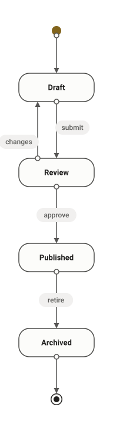

<p align="center"></p>

<p align="center"><b>English</b> · <a href="README.ko.md">한국어</a></p>

<p align="center"><b>Draws Mermaid text as SVG and as terminal text. No browser, no runtime dependencies.</b></p>

<p align="center"><a href="https://yjun1806.github.io/ursula-diagram/">Docs and playground</a> · <a href="https://yjun1806.github.io/ursula-diagram/playground">Try it in the browser</a></p>

<p align="center">
  <a href="#why-ursula">Why ursula</a> ·
  <a href="#compared-with-other-tools">Compared</a> ·
  <a href="#quick-start">Quick start</a> ·
  <a href="#gallery">Gallery</a> ·
  <a href="#a-larger-drawing">A larger drawing</a> ·
  <a href="#in-a-terminal">In a terminal</a> ·
  <a href="#output-formats">Output formats</a> ·
  <a href="#library">Library</a> ·
  <a href="#agent-skill">Agent skill</a>
</p>

ursula reads the Mermaid text of any of the 35 diagram types in the Mermaid documentation and computes where every
box, line and label goes. It is made for coding agents: the agent writes a few lines of Mermaid, and the engine lays
them out, as an SVG or as a drawing for the agent's terminal, in a median of 0.36 ms. The same text always gives the
same drawing. It runs on Node alone: no browser, no DOM, nothing to install at run time.

```
flowchart LR
  order([Order placed]) --> pay{Paid?}
  pay -->|yes| pick[Pick items]
  pay -->|no| remind[Send reminder]
  remind --> pay
  pick --> ship([Ship])
```

```
                                         ┌────────────┐   ┌────────────┐
                                ┌─ yes ─▶│ Pick items │──▶│    Ship    │
┌────────────┐   ┌────────────┐ │        └────────────┘   └────────────┘
│   Order    │──▶│   Paid?    │─┤
│   placed   │   └────────────┘ │        ┌────────────┐
└────────────┘          ▲       └─ no ──▶│    Send    │
                        │                │  reminder  │
                        │                └────────────┘
                        │                       │
                        └───────────────────────┘
```

<p align="center"></p>

The first block is the input. The text drawing and the picture under it are what ursula draws from it, with
`--format text --width 80` and with `--format svg`.

## Why ursula

An agent that wants to show a diagram usually takes one of two roads.

- **A drawing skill.** The model plans the layout itself, writes the coordinates or a script that computes them,
  checks the result and plans again. The pictures can look hand-made, with zones, a legend and emphasis chosen for
  each one. But every round of planning and checking is another model turn, so one drawing takes many turns and many
  tokens, and the same request can come out different the next time.
- **Mermaid as it is.** The model writes Mermaid text and Mermaid draws it. This is fast and cheap for the model,
  but Mermaid draws in a browser (or, from the command line, in a headless Chromium), the model cannot see what the
  layout came out like, and in a terminal the reader sees only the source text.

ursula sits between the two. The model writes Mermaid only, never a coordinate: the official examples have a
median of 154 bytes of text, and the order flowchart above is 315. The engine does the layout, with no model in the
loop, so the same text gives the same drawing. One engine draws both an SVG and a drawing in terminal cells, so the
picture also shows up where an agent actually answers: in the terminal.

Measured on an Apple M2 Max with Node 26, over the 531 examples in the Mermaid documentation, each drawn five
times (the last two rows: one flowchart, six runs of the command each):

| | Median | Slowest |
| --- | --- | --- |
| SVG, from the library | 0.36 ms | 79.6 ms |
| Terminal text at width 100, from the library | 0.29 ms | 46.3 ms |
| One run of the command, order flowchart, `--format text` | 0.15 s | |
| One run of the command, order flowchart, `--format svg` | 0.35 s | |

A run of the command is mostly the start of Node and the reading of the one-file bundle (1.56 MB).
In place of the model looking at its own picture, `--format check` prints the count of bends and crossings and,
sometimes, a question about the text. The agent skill answers the questions once and then draws; it does not loop.

## Compared with other tools

Each of these does something ursula does not. The table says what was measured; a cell that says *not checked* was
not measured here. The counts of examples are out of the 531 examples in the Mermaid documentation, 35 types.

| | Output | What it draws | Runs on | Speed | In a terminal | Korean and other wide characters |
| --- | --- | --- | --- | --- | --- | --- |
| **ursula** 0.1.0 | SVG, terminal text, text as SVG, one-file HTML, JSON | 530 of 531; all 35 types | Node 22+, no runtime dependencies, no browser | Median under 1 ms in the library; 0.1–0.4 s per command run | Yes: 21 types as boxes and lines, 14 as a table or a list | Counted in terminal cells: no extra breaks in 13 Korean test drawings. Emoji counted one cell wide (wrong) |
| **A drawing skill** | SVG or HTML the model writes | Whatever the model can lay out; layout chosen per picture | The agent's model | Many model turns per drawing (not measured) | Not checked | Not checked |
| **Mermaid** in a browser (12.3.0) | SVG | 515 of 531 (fails on ZenUML) | A browser; 22 dependencies | Not checked | Not checked | Not checked |
| **mermaid-cli** (12.2.0) | SVG, PNG | Mermaid's types (not counted) | Node 22.13+ and Chromium through Puppeteer | Not checked | No | Not checked |
| **Text drawing tools**: mermaid-ascii, termaid, mmdflux, beautiful-mermaid | Terminal text; mmdflux and beautiful-mermaid also SVG | mmdflux 206 of 531 in 4 types; beautiful-mermaid 226 of 531 in 6 types; the others not counted | Go (mermaid-ascii), Python (termaid), Rust (mmdflux), a Node library (beautiful-mermaid) | mmdflux 7.9 ms per process run; the others not checked | Yes | termaid: no extra breaks in 13 of 13. mermaid-ascii: none in the 10 it drew. mmdflux: one (a label over a crossing) in the 11 it drew. All three count emoji as two cells. beautiful-mermaid 1.1.2 counts characters, not cells, and breaks all 13 Korean drawings |

Per process, mmdflux is about 12 times faster than the `ursula-diagram` command (median 7.9 ms against 99 ms over the 116
flowchart examples); the difference is mostly the start of Node. Inside one program ursula is under 1 ms too.

### When ursula is not the better choice

- **You want a picture tuned by hand.** A drawing skill or a person picks zones, a legend and emphasis for each
  picture. ursula has one look and changes only its colours (through CSS variables). Some types keep fewer lines
  straight: in the official examples, 87% of the lines are straight in flowcharts but 60% in C4 and 67% in use case
  drawings, and Event Modeling lines all bend.
- **You need a PNG from the command line.** mermaid-cli writes one. ursula saves a PNG only from its `html` page.
- **You call it once per process in a tight loop.** A native binary such as mmdflux starts about 12 times faster.
  Calling the library from one Node program avoids the cost.
- **Your labels have emoji and the drawing goes to a terminal.** ursula counts an emoji as one cell, so the right
  edge of that box moves one cell; mermaid-ascii, mmdflux and termaid count two.
- **You want a chart drawn in a terminal.** Pie, XY chart, radar, quadrant, Sankey, Wardley, timeline, user
  journey, railroad, Venn and Cynefin come out as tables or lists there, not as pictures.
- **Your subgraphs nest and the drawing goes to a terminal.** A nested subgraph is drawn as a band named
  `outer / inner`, not as a box inside a box, so the nesting is not visible.
- **You need a settled API.** This is the first release, 0.1.0. The library ignores an option it does not know,
  without a warning (the command refuses it).

## Quick start

Install the `ursula-diagram` command with npm (Node 22 or later; `ursula` is a short alias), or run it once with `npx`:

```bash
npm install -g ursula-diagram
npx ursula-diagram order.mmd --format text   # without installing
```

```bash
cat > order.mmd <<'EOF'
flowchart LR
  order([Order placed]) --> pay{Paid?}
  pay -->|yes| pick[Pick items]
  pay -->|no| remind[Send reminder]
  remind --> pay
  pick --> ship([Ship])
EOF
ursula-diagram order.mmd --format text --width 80   # the text drawing above
ursula-diagram order.mmd --format svg > order.svg   # the picture above
```


## Gallery

Every picture below is the output of `ursula-diagram <file> --format svg`, unedited.

<table>
  <tr>
    <td align="center"><b>Flowchart</b><br></td>
    <td align="center"><b>Sequence</b><br></td>
  </tr>
  <tr>
    <td align="center"><b>Class</b><br></td>
    <td align="center"><b>State</b><br></td>
  </tr>
  <tr>
    <td align="center"><b>Entity relationship</b><br></td>
    <td align="center"><b>C4 context</b><br></td>
  </tr>
  <tr>
    <td align="center" colspan="2"><b>Mindmap</b><br></td>
  </tr>
  <tr>
    <td align="center" colspan="2"><b>Gantt</b><br></td>
  </tr>
</table>

<details>
<summary>The Mermaid text of each picture</summary>

```
flowchart LR
  A([Start]) --> B{Valid?}
  B -->|yes| C[Save]
  B -->|no| D[Show error]
  D --> A
  C --> E([Done])
```

```
sequenceDiagram
  actor U as User
  participant W as Web
  participant A as Auth API
  participant D as DB
  U->>W: Log in
  W->>A: POST /login
  A->>D: Find user
  D-->>A: Record
  A-->>W: Token
  W-->>U: Dashboard
```

```
classDiagram
  class Order {
    +id: string
    +total(): number
  }
  class Line {
    +qty: number
  }
  class Product {
    +name: string
  }
  class Customer {
    +email: string
  }
  Customer "1" --> "*" Order
  Order *-- "1..*" Line
  Line --> Product
```

```
stateDiagram-v2
  [*] --> Draft
  Draft --> Review: submit
  Review --> Draft: changes
  Review --> Published: approve
  Published --> Archived: retire
  Archived --> [*]
```

```
erDiagram
  CUSTOMER ||--o{ ORDER : places
  ORDER ||--|{ LINE_ITEM : contains
  PRODUCT ||--o{ LINE_ITEM : "ordered in"
  CUSTOMER {
    string id PK
    string email
  }
  ORDER {
    string id PK
    date placed
  }
```

```
C4Context
  Person(buyer, "Shopper", "Buys things")
  System(store, "Web Shop", "Takes orders")
  System_Ext(pay, "Payment Gateway", "Charges cards")
  System_Ext(mail, "Mail Service", "Sends email")
  Rel(buyer, store, "Orders from")
  Rel(store, pay, "Charges via")
  Rel(store, mail, "Sends receipts via")
```

```
gantt
  title Release
  dateFormat YYYY-MM-DD
  section Build
  Design   :a1, 2026-01-05, 5d
  Engine   :a2, after a1, 10d
  section Ship
  Docs     :b1, after a2, 4d
  Release  :milestone, after b1, 0d
```

```
mindmap
  root((Diagrams))
    Flow
      Flowchart
      Swimlanes
    Structure
      Class
      ER
    Time
      Gantt
      Timeline
```

</details>

### Every type it draws

The type is read from the first line of the text, as Mermaid does. All 35:

Architecture, Block, C4, Class, Cynefin, Entity Relationship, Event Modeling, Flowchart, Gantt, Git Graph, Ishikawa,
Kanban, Mindmap, Packet, Pie, Quadrant, Radar, Railroad (IR, ABNF, EBNF, PEG), Requirement, Sankey, Sequence, State,
Swimlanes, Timeline, TreeView, Treemap, Use Case, User Journey, Venn, Wardley Map, XY Chart, ZenUML.

## A larger drawing

Two C4 examples from the Mermaid documentation, drawn as they are. The container diagram has 10 elements, 13
relations and a boundary; people and systems outside the boundary connect to the apps inside it. The deployment
diagram nests nodes three deep (data center, server, Tomcat, application) and ends in a replicated database. Both come
out with no crossings (`--format check`: 7 and 4 bends).

<p align="center"></p>
<p align="center"></p>

The texts are in [examples/c4-container.mmd](examples/c4-container.mmd) and
[examples/c4-deployment.mmd](examples/c4-deployment.mmd). The terminal draws them too, but at this size it shortens
long relation labels and draws the boundary as a band, so for drawings like these the SVG reads better.

## In a terminal

`--format text` draws with box-drawing characters and arranges the drawing for `--width`. The order flowchart at the
top runs left to right at `--width 80`; at `--width 40` the same text comes out stacked top to bottom. A drawing is
never cut off. These are the gallery's sequence, Gantt and mindmap texts, drawn with
`ursula-diagram <file> --format text --width 80`.

```
┌───────────────┐   ┌─────┐       ┌───────────┐     ┌─────┐
│ [actor] User  │   │ Web │       │ Auth API  │     │ DB  │
└───────────────┘   └─────┘       └───────────┘     └─────┘
        ├── Log in ───▶┆                ┆              ┆
        ┆              ├─ POST /login ─▶┆              ┆
        ┆              ┆                ├─ Find user ─▶┆
        ┆              ┆                ┆◀┄┄ Record ┄┄┄┤
        ┆              ┆◀┄┄┄┄ Token ┄┄┄┄┤              ┆
        ┆◀┄ Dashboard ┄┤                ┆              ┆

─▶ Call   ┄▶ Reply
```

```
Release
          January 2026
          5  6  7  8  9  10 11 12 13 14 15 16 17 18 19 20 21 22 23 24
──────────┬──┬──┬──┬──┬──┬──┬──┬──┬──┬──┬──┬──┬──┬──┬──┬──┬──┬──┬──
Build
  Design  ███████████████ 5d
  Engine                 ██████████████████████████████ 10d
Ship
  Docs                                                 ████████████ 4d
  Release                                                         ◆ 0d milestone
```

```
Diagrams
├── Flow
│   ├── Flowchart
│   └── Swimlanes
├── Structure
│   ├── Class
│   └── ER
└── Time
    ├── Gantt
    └── Timeline
```

A few types (pie, quadrant, radar, sankey, XY chart, timeline, user journey, railroad, Venn, Cynefin, Wardley) come
out as a table or a list in a terminal, because that is more exact there than a picture:

```
pie title Pets
  "Dogs" : 386
  "Cats" : 85
  "Rats" : 15
```

```
Pets
Dogs  386  79.4%
Cats   85  17.5%
Rats   15   3.1%
```

When a drawing cannot fit in `--width`, the command prints no drawing, ends with code 3 and names a width that fits.
`--check` with any drawing format adds the engine's report on standard error: the counts, the lines that cross with
their source line numbers, and questions. The report counts the svg layout; a terminal drawing routes its lines on its
own grid, so its crossings can differ. `ursula-diagram syntax` lists every type, and
`ursula-diagram syntax <type>` prints a small example and the rules. An error names the line and the column and,
when it can, the word that was meant and a line written the right way:

```
error: line 1: expected a 'flowchart' or 'graph' header
  1 | flowchrt LR
    | ^^^^^^^^
did you mean: flowchart
example: flowchart LR
```

The exit code is 0 when drawn, 1 for an error in the text, 2 for wrong options, 3 when the drawing is too wide and 4
for a failure inside the engine. `ursula-diagram --help` lists every option.

### When the columns do not line up

A text drawing keeps its columns only where every character is as wide as the engine counts it: one cell for a line
or an arrowhead, two for a Korean, Chinese or Japanese character. A real terminal does that. A chat window, a web
page or a code block in a document often does not, and the boxes come apart. GitHub's code block is one such
place: in Chrome on a Mac it draws a Korean character 1.44 cells wide (measured; it depends on the system and the
font), which is why every text drawing in this file uses Latin letters only.

There are two ways out:

- **`--format text-svg`** draws the same terminal drawing as one SVG. It draws the lines as shapes and sets every
  word on the grid, so no font moves a column. Below, a drawing with Korean labels:

  

- **`--charset ascii`** draws with ASCII characters only, for a terminal that draws box lines two cells wide:

  ```
                                           +------------+   +------------+
                                  +- yes ->| Pick items |-->|    Ship    |
  +------------+   +------------+ |        +------------+   +------------+
  |   Order    |-->|   Paid?    |-+
  |   placed   |   +------------+ |        +------------+
  +------------+          ^       +- no -->|    Send    |
                          |                |  reminder  |
                          |                +------------+
                          |                       |
                          +-----------------------+
  ```

<details>
<summary>Which characters <code>--charset ascii</code> replaces</summary>

| | `unicode` (default) | `ascii` |
| --- | --- | --- |
| Line, heavy line, dashed line | `─ │` `━ ┃` `┄ ┆` | `- \|` `= #` `. :` |
| Corner, tee, crossing; rounded corner | `┌ ├ ┼`; `╭ ╮ ╰ ╯` | `+`; `/ \ \ /` |
| Arrowhead; hollow arrowhead | `▶ ◀ ▼ ▲`; `──▷` | `> < v ^`; `--\|>` |
| Filled and open diamond, dots, bar | `◆ ◇` `● ◉` `█` | `@ o` `* @` `#` |
| Cut-off text | `…` | `~` |

The text of the diagram is kept as written. The characters of the table are replaced wherever they stand, and so
are a few symbols that some terminals draw two cells wide (`·` `×` `—` `∩` `⊕`).

</details>

## Output formats

| `--format` | What you get |
| --- | --- |
| `svg` (default) | One inline SVG. Colours are CSS variables; light and dark follow the viewer. |
| `text` | Box-drawing characters, laid out for `--width`. No colour codes unless you add `--color`. |
| `text-svg` | The terminal drawing as one SVG, for where text would lose its columns. |
| `html` | One file with the drawing, a light and dark switch, and saving as PNG or SVG. |
| `json` | The placement: boxes, lines and labels with their coordinates. |
| `check` | One line of counts (bends, crossings) and, sometimes, questions a writer can answer by editing the text. |

```bash
ursula-diagram flow.mmd --format svg > flow.svg
ursula-diagram flow.mmd --format text --width 100
ursula-diagram flow.mmd --format text --width 100 --charset ascii
ursula-diagram flow.mmd --format text-svg --width 100 > flow-text.svg
ursula-diagram flow.mmd --format html --theme dark --title "Flow" > flow.html
ursula-diagram flow.mmd --format check
cat flow.mmd | ursula --format json
```

The command reads standard input when no file is given. `--theme auto|light|dark` sets the light or dark of an
`html` page; `auto` follows the system setting. Run `ursula-diagram --help` to list every option.

## Library

```ts
import { render, renderText, renderTextSvg } from 'ursula-diagram';
import { renderHtml } from 'ursula-diagram/html';

const src = `flowchart LR
  A[Start] --> B{Ok?}
  B -->|yes| C[Done]
  B -->|no| A`;

const svg = render(src);                 // string of inline SVG
const text = renderText(src, 80);        // { lines: string[] } or { error: string }
const ascii = renderText(src, 80, { charset: 'ascii' });
const picture = renderTextSvg(src, 80);  // { svg: string } or { error: string }
const page = renderHtml(src, { title: 'Flow' });
```

`render` throws an `UrsulaError` with a message for the writer when the text cannot be drawn. `renderText` returns
the message as `{ error }`, also when the drawing does not fit the width: it never cuts a drawing off.

`renderTextSpans` returns the same lines as spans with a tone (`normal`, `dim`, `bold`, `accent`), for a host that
colours terminal text itself. `spansToSvg` draws such lines as the picture `renderTextSvg` returns, and `toAscii`
replaces the drawing characters of lines already drawn; give it `{ countBars: true }` for the lines of an
entity-relationship drawing, so that the bars of its counts on upright lines become `-`.

## Colours

An SVG drawing reads every colour from a CSS variable and carries the value as a fallback, so it looks right on its
own and follows a page that sets the variables. Each has a light and a dark value; the dark one applies under
`prefers-color-scheme: dark`.

```css
:root {
  --ursula-accent: #0b6e4f;
  --ursula-start-fill: #bfe3d0;
}
```

<details>
<summary>All colour variables</summary>

| Variable | What it colours | Light | Dark |
| --- | --- | --- | --- |
| `--ursula-fg` | Names and body text | `#201f1e` | `#efeeec` |
| `--ursula-muted` | Second lines and labels | `#5b5b59` | `#b2b1af` |
| `--ursula-faint` | Text and marks that stand back | `#878685` | `#757472` |
| `--ursula-line` | A line between boxes | `#565554` | `#a5a4a2` |
| `--ursula-border` | The outline of a box | `#484846` | `#bebdbb` |
| `--ursula-hair` | Zone outlines, rules and grid lines | `#e2e1e0` | `#2c2b2a` |
| `--ursula-surface` | The face of a box and of the page | `#fcfcfa` | `#171614` |
| `--ursula-lane` | Filled bands: lanes, zones, head bands, tags | `#efeeed` | `#252422` |
| `--ursula-chip-fill` | Label chips and notes | `#f1f0ef` | `#252422` |
| `--ursula-accent` | The accent as a stroke or a text | `#82641c` | `#dab975` |
| `--ursula-start-fill` | The face of a start box and of the highest bar | `#e5c37a` | `#dab975` |
| `--ursula-accent-tint` | A pale accent face | `#f6ecd7` | `#372c15` |
| `--ursula-on-accent` | Text on the face of a start box | `#201f1e` | `#171614` |
| `--ursula-bg` | The background of flowchart, class, state, ER, requirement, C4 and use case drawings | `transparent` | `transparent` |
| `--ursula-panel` | The panel behind a chart | `none` | `none` |
| `--ursula-bar` | A neutral bar of a chart | `#c8c7c6` | `#434241` |
| `--ursula-tint-outer` | The outermost boundary of a C4 drawing | `#f4f3f1` | `#1e1d1b` |
| `--ursula-tint-inner` | The innermost boundary of a C4 drawing | `#f6f5f3` | `#1c1b19` |
| `--ursula-tint-chip` | A label chip on a boundary fill | `#ebeae8` | `#262523` |
| `--ursula-s1` … `--ursula-s8` | The eight series of a chart | | |
| `--ursula-s1-tint` … `--ursula-s8-tint` | The pale area fill of each series | | |

</details>

## Agent skill

`skills/ursula` is a skill for coding agents. `SKILL.md` tells the agent how to write the Mermaid text, how to
draw it and ask the engine about it in one call with `--check`, and which output to give the reader. `scripts/ursula.mjs` is the
command as one file, so the skill runs with Node 22 or later and installs nothing.

Install it with the [skills](https://skills.sh) command, which works for Claude Code, Codex, Cursor and other
agents:

```bash
npx skills add yjun1806/ursula-diagram            # into this project
npx skills add yjun1806/ursula-diagram -g         # for every project
npx skills add yjun1806/ursula-diagram -a claude-code   # for one agent only
```

Or copy the `skills/ursula` folder into the skills folder of your agent by hand. The npm package carries it too:

```bash
cp -R "$(npm root -g)/ursula-diagram/skills/ursula" ~/.claude/skills/
```

With the skill, the agent writes the Mermaid text, draws it with `--check`, and picks the output by where the reader
is: `text` for a terminal, `text-svg` for a chat or a web page, `svg` or `html` for a file.

### Over MCP

Where an agent has no shell, `ursula-diagram mcp` serves the command over MCP on standard input and output. It has
three tools: `render` (with `format`, `width`, `charset`, and `check` for the report), `check` and `syntax`.

```bash
claude mcp add ursula -- npx -y ursula-diagram mcp    # Claude Code
```

```json
{ "mcpServers": { "ursula": { "command": "npx", "args": ["-y", "ursula-diagram", "mcp"] } } }
```

The second is for `claude_desktop_config.json` of Claude Desktop, and for other clients that take the same form.

### In an agent's terminal

A host that shows an agent's replies can also draw the diagrams itself, with no skill and no extra turn: find each
` ```mermaid ` block in the reply and put the drawing in its place. A Claude Code mod that redraws the replies in
the terminal is one such host. `renderTextSpans` gives each line as spans with a tone, and the host picks the
colour of each tone:

````ts
import { renderTextSpans } from 'ursula-diagram';

const TONE = { normal: '', dim: '\x1b[2m', bold: '\x1b[1m', accent: '\x1b[33m' };

function drawMermaidBlocks(reply: string, width: number): string {
  return reply.replace(/```mermaid\n([\s\S]*?)```/g, (block, src) => {
    const out = renderTextSpans(src, width);
    if ('error' in out) return block; // keep the text when it cannot be drawn
    return out.lines
      .map((line) => line.map((s) => TONE[s.tone] + s.text + '\x1b[0m').join(''))
      .join('\n');
  });
}
````

The drawing never goes past `width`: when it does not fit, `renderTextSpans` returns `{ error }`, and the block
stays as text.

## Development

```bash
npm install
npx tsc --noEmit
npm test              # the whole suite but the slow comparisons
npm run test:rewrite  # the slow comparisons of the layered engine, about a quarter of an hour
bun scripts/build.ts  # dist/ and the command inside the skill; run it again when a drawing changes
cd site && npm install && npm run dev   # the documentation site and playground, on the dist/ just built
```

The built files run on Node 22 or later. In a checkout, Node 24 or later also runs the sources directly:
`node src/cli.ts order.mmd --format text`.
