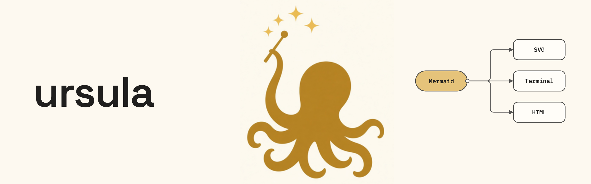
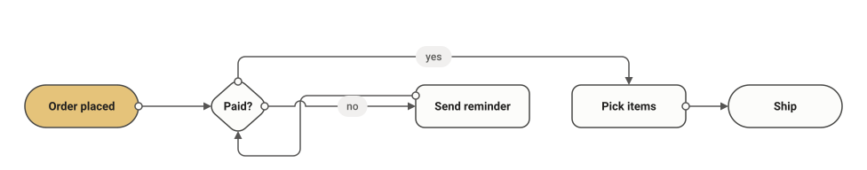
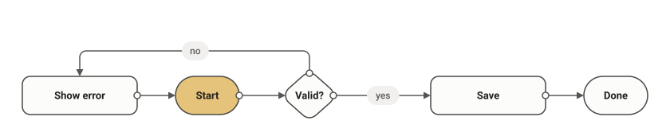
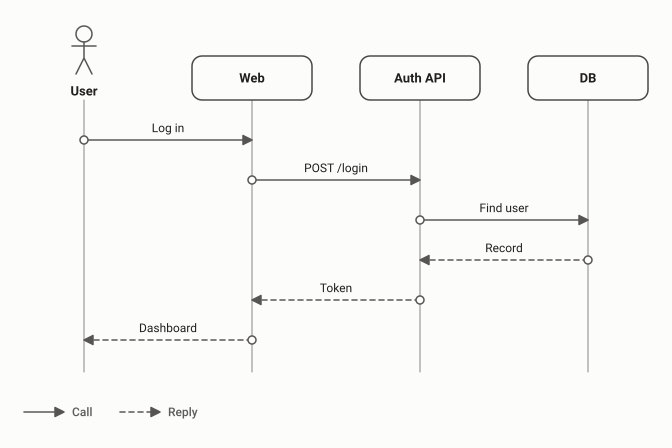
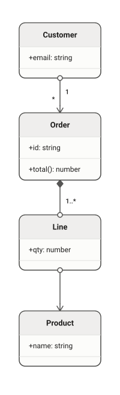
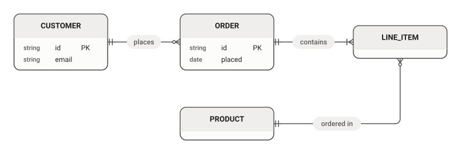
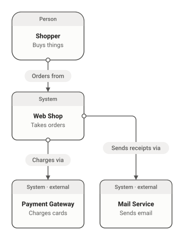
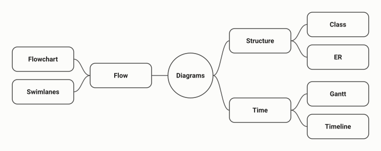
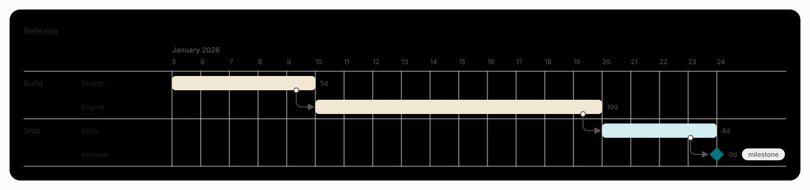
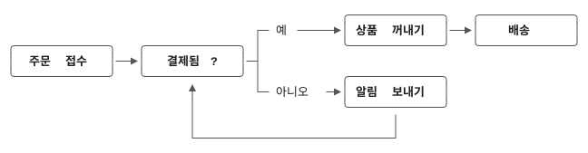

<p align="center"></p>

<p align="center"><b>English</b> · <a href="README.ko.md">한국어</a></p>

<p align="center"><b>Draws Mermaid text as SVG and as terminal text. No browser, no runtime dependencies.</b></p>

<p align="center">
  <a href="#quick-start">Quick start</a> ·
  <a href="#gallery">Gallery</a> ·
  <a href="#in-a-terminal">In a terminal</a> ·
  <a href="#output-formats">Output formats</a> ·
  <a href="#library">Library</a> ·
  <a href="#agent-skill">Agent skill</a>
</p>

ursula reads the Mermaid text of any of the 35 diagram types in the Mermaid documentation and computes where every
box, line and label goes. The same text always gives the same drawing. It runs on Node alone: no browser, no DOM,
nothing to install at run time.

```
flowchart LR
  order([Order placed]) --> pay{Paid?}
  pay -->|yes| pick[Pick items]
  pay -->|no| remind[Send reminder]
  remind --> pay
  pick --> ship([Ship])
```

```
┌─────────────┐   ┌─────────────┐        ┌─────────────┐   ┌─────────────┐
│    Order    │──▶│    Paid?    │─ yes ─▶│ Pick items  │──▶│    Ship     │
│   placed    │   │             │        │             │   │             │
└─────────────┘   └─────────────┘        └─────────────┘   └─────────────┘
                        ▲│  no
                        │▼
                  ┌─────────────┐
                  │    Send     │
                  │  reminder   │
                  └─────────────┘
```

<p align="center"></p>

The first block is the input. The text drawing and the picture under it are what ursula draws from it, with
`--format text --width 80` and with `--format svg`.

## Quick start

ursula is not published to a package registry yet. Clone this repository and run the command from its folder.
The sources run directly on Node 24 or later.

```bash
cat > order.mmd <<'EOF'
flowchart LR
  order([Order placed]) --> pay{Paid?}
  pay -->|yes| pick[Pick items]
  pay -->|no| remind[Send reminder]
  remind --> pay
  pick --> ship([Ship])
EOF
node src/cli.ts order.mmd --format text --width 80   # the text drawing above
node src/cli.ts order.mmd --format svg > order.svg   # the picture above
```

On Node 22, use the bundled one-file command instead: `node skills/ursula/scripts/ursula.mjs order.mmd --format text`.
It takes the same options.

## Gallery

Every picture below is the output of `node src/cli.ts <file> --format svg`, unedited.

<table>
  <tr>
    <td align="center"><b>Flowchart</b><br></td>
    <td align="center"><b>Sequence</b><br></td>
  </tr>
  <tr>
    <td align="center"><b>Class</b><br></td>
    <td align="center"><b>State</b><br></td>
  </tr>
  <tr>
    <td align="center"><b>Entity relationship</b><br></td>
    <td align="center"><b>C4 context</b><br></td>
  </tr>
  <tr>
    <td align="center" colspan="2"><b>Mindmap</b><br></td>
  </tr>
  <tr>
    <td align="center" colspan="2"><b>Gantt</b><br></td>
  </tr>
</table>

<details>
<summary>The Mermaid text of each picture</summary>

```
flowchart LR
  A([Start]) --> B{Valid?}
  B -->|yes| C[Save]
  B -->|no| D[Show error]
  D --> A
  C --> E([Done])
```

```
sequenceDiagram
  actor U as User
  participant W as Web
  participant A as Auth API
  participant D as DB
  U->>W: Log in
  W->>A: POST /login
  A->>D: Find user
  D-->>A: Record
  A-->>W: Token
  W-->>U: Dashboard
```

```
classDiagram
  class Order {
    +id: string
    +total(): number
  }
  class Line {
    +qty: number
  }
  class Product {
    +name: string
  }
  class Customer {
    +email: string
  }
  Customer "1" --> "*" Order
  Order *-- "1..*" Line
  Line --> Product
```

```
stateDiagram-v2
  [*] --> Draft
  Draft --> Review: submit
  Review --> Draft: changes
  Review --> Published: approve
  Published --> Archived: retire
  Archived --> [*]
```

```
erDiagram
  CUSTOMER ||--o{ ORDER : places
  ORDER ||--|{ LINE_ITEM : contains
  PRODUCT ||--o{ LINE_ITEM : "ordered in"
  CUSTOMER {
    string id PK
    string email
  }
  ORDER {
    string id PK
    date placed
  }
```

```
C4Context
  Person(buyer, "Shopper", "Buys things")
  System(store, "Web Shop", "Takes orders")
  System_Ext(pay, "Payment Gateway", "Charges cards")
  System_Ext(mail, "Mail Service", "Sends email")
  Rel(buyer, store, "Orders from")
  Rel(store, pay, "Charges via")
  Rel(store, mail, "Sends receipts via")
```

```
gantt
  title Release
  dateFormat YYYY-MM-DD
  section Build
  Design   :a1, 2026-01-05, 5d
  Engine   :a2, after a1, 10d
  section Ship
  Docs     :b1, after a2, 4d
  Release  :milestone, after b1, 0d
```

```
mindmap
  root((Diagrams))
    Flow
      Flowchart
      Swimlanes
    Structure
      Class
      ER
    Time
      Gantt
      Timeline
```

</details>

### Every type it draws

The type is read from the first line of the text, as Mermaid does. All 35:

Architecture, Block, C4, Class, Cynefin, Entity Relationship, Event Modeling, Flowchart, Gantt, Git Graph, Ishikawa,
Kanban, Mindmap, Packet, Pie, Quadrant, Radar, Railroad (IR, ABNF, EBNF, PEG), Requirement, Sankey, Sequence, State,
Swimlanes, Timeline, TreeView, Treemap, Use Case, User Journey, Venn, Wardley Map, XY Chart, ZenUML.

## In a terminal

`--format text` draws with box-drawing characters and arranges the drawing for `--width`. The order flowchart at the
top runs left to right at `--width 80`; at `--width 40` the same text comes out stacked top to bottom. A drawing is
never cut off. These are the gallery's sequence, Gantt and mindmap texts, drawn with
`node src/cli.ts <file> --format text --width 80`.

```
┌───────────────┐   ┌─────┐       ┌───────────┐     ┌─────┐
│ [actor] User  │   │ Web │       │ Auth API  │     │ DB  │
└───────────────┘   └─────┘       └───────────┘     └─────┘
        ├── Log in ───▶┆                ┆              ┆
        ┆              ├─ POST /login ─▶┆              ┆
        ┆              ┆                ├─ Find user ─▶┆
        ┆              ┆                ┆◀┄┄ Record ┄┄┄┤
        ┆              ┆◀┄┄┄┄ Token ┄┄┄┄┤              ┆
        ┆◀┄ Dashboard ┄┤                ┆              ┆

─▶ Call   ┄▶ Reply
```

```
Release
          January 2026
          5  6  7  8  9  10 11 12 13 14 15 16 17 18 19 20 21 22 23 24
──────────┬──┬──┬──┬──┬──┬──┬──┬──┬──┬──┬──┬──┬──┬──┬──┬──┬──┬──┬──
Build
  Design  ███████████████ 5d
  Engine                 ██████████████████████████████ 10d
Ship
  Docs                                                 ████████████ 4d
  Release                                                         ◆ 0d milestone
```

```
Diagrams
├── Flow
│   ├── Flowchart
│   └── Swimlanes
├── Structure
│   ├── Class
│   └── ER
└── Time
    ├── Gantt
    └── Timeline
```

A few types (pie, quadrant, radar, sankey, XY chart, timeline, user journey, railroad, Venn, Cynefin, Wardley) come
out as a table or a list in a terminal, because that is more exact there than a picture:

```
pie title Pets
  "Dogs" : 386
  "Cats" : 85
  "Rats" : 15
```

```
Pets
Dogs  386  79.4%
Cats   85  17.5%
Rats   15   3.1%
```

### When the columns do not line up

A text drawing keeps its columns only where every character is as wide as the engine counts it: one cell for a line
or an arrowhead, two for a Korean, Chinese or Japanese character. A real terminal does that. A chat window, a web
page or a code block in a document often does not, and the boxes come apart. GitHub's code block is one such
place: in Chrome on a Mac it draws a Korean character 1.44 cells wide (measured; it depends on the system and the
font), which is why every text drawing in this file uses Latin letters only.

There are two ways out:

- **`--format text-svg`** draws the same terminal drawing as one SVG. It draws the lines as shapes and sets every
  word on the grid, so no font moves a column. Below, a drawing with Korean labels:

  

- **`--charset ascii`** draws with ASCII characters only, for a terminal that draws box lines two cells wide:

  ```
  +-------------+   +-------------+        +-------------+   +-------------+
  |    Order    |-->|    Paid?    |- yes ->| Pick items  |-->|    Ship     |
  |   placed    |   |             |        |             |   |             |
  +-------------+   +-------------+        +-------------+   +-------------+
                          ^|  no
                          |v
                    +-------------+
                    |    Send     |
                    |  reminder   |
                    +-------------+
  ```

<details>
<summary>Which characters <code>--charset ascii</code> replaces</summary>

| | `unicode` (default) | `ascii` |
| --- | --- | --- |
| Line, heavy line, dashed line | `─ │` `━ ┃` `┄ ┆` | `- \|` `= #` `. :` |
| Corner, tee, crossing; rounded corner | `┌ ├ ┼`; `╭ ╮ ╰ ╯` | `+`; `/ \ \ /` |
| Arrowhead; hollow arrowhead | `▶ ◀ ▼ ▲`; `──▷` | `> < v ^`; `--\|>` |
| Filled and open diamond, dots, bar | `◆ ◇` `● ◉` `█` | `@ o` `* @` `#` |
| Cut-off text | `…` | `~` |

The text of the diagram is kept as written. The characters of the table are replaced wherever they stand, and so
are a few symbols that some terminals draw two cells wide (`·` `×` `—` `∩` `⊕`).

</details>

## Output formats

| `--format` | What you get |
| --- | --- |
| `svg` (default) | One inline SVG. Colours are CSS variables; light and dark follow the viewer. |
| `text` | Box-drawing characters, laid out for `--width`. No colour codes unless you add `--color`. |
| `text-svg` | The terminal drawing as one SVG, for where text would lose its columns. |
| `html` | One file with the drawing, a light and dark switch, and saving as PNG or SVG. |
| `json` | The placement: boxes, lines and labels with their coordinates. |
| `check` | One line of counts (bends, crossings) and, sometimes, questions a writer can answer by editing the text. |

```bash
node src/cli.ts flow.mmd --format svg > flow.svg
node src/cli.ts flow.mmd --format text --width 100
node src/cli.ts flow.mmd --format text --width 100 --charset ascii
node src/cli.ts flow.mmd --format text-svg --width 100 > flow-text.svg
node src/cli.ts flow.mmd --format html --theme dark --title "Flow" > flow.html
node src/cli.ts flow.mmd --format check
cat flow.mmd | node src/cli.ts --format json
```

The command reads standard input when no file is given. `--theme auto|light|dark` sets the light or dark of an
`html` page; `auto` follows the system setting. Run `node src/cli.ts --help` to list every option.

## Library

```ts
import { render, renderText, renderTextSvg } from './src/index.ts';
import { renderHtml } from './src/html.ts';

const src = `flowchart LR
  A[Start] --> B{Ok?}
  B -->|yes| C[Done]
  B -->|no| A`;

const svg = render(src);                 // string of inline SVG
const text = renderText(src, 80);        // { lines: string[] } or { error: string }
const ascii = renderText(src, 80, { charset: 'ascii' });
const picture = renderTextSvg(src, 80);  // { svg: string } or { error: string }
const page = renderHtml(src, { title: 'Flow' });
```

`render` throws an `UrsulaError` with a message for the writer when the text cannot be drawn. `renderText` returns
the message as `{ error }`, also when the drawing does not fit the width: it never cuts a drawing off.

`renderTextSpans` returns the same lines as spans with a tone (`normal`, `dim`, `bold`, `accent`), for a host that
colours terminal text itself. `spansToSvg` draws such lines as the picture `renderTextSvg` returns, and `toAscii`
replaces the drawing characters of lines already drawn; give it `{ countBars: true }` for the lines of an
entity-relationship drawing, so that the bars of its counts on upright lines become `-`.

## Colours

An SVG drawing reads every colour from a CSS variable and carries the value as a fallback, so it looks right on its
own and follows a page that sets the variables. Each has a light and a dark value; the dark one applies under
`prefers-color-scheme: dark`.

```css
:root {
  --ursula-accent: #0b6e4f;
  --ursula-start-fill: #bfe3d0;
}
```

<details>
<summary>All colour variables</summary>

| Variable | What it colours | Light | Dark |
| --- | --- | --- | --- |
| `--ursula-fg` | Names and body text | `#201f1e` | `#efeeec` |
| `--ursula-muted` | Second lines and labels | `#5b5b59` | `#b2b1af` |
| `--ursula-faint` | Text and marks that stand back | `#878685` | `#757472` |
| `--ursula-line` | A line between boxes | `#565554` | `#a5a4a2` |
| `--ursula-border` | The outline of a box | `#484846` | `#bebdbb` |
| `--ursula-hair` | Zone outlines, rules and grid lines | `#e2e1e0` | `#2c2b2a` |
| `--ursula-surface` | The face of a box and of the page | `#fcfcfa` | `#171614` |
| `--ursula-lane` | Filled bands: lanes, zones, head bands, tags | `#efeeed` | `#252422` |
| `--ursula-chip-fill` | Label chips and notes | `#f1f0ef` | `#252422` |
| `--ursula-accent` | The accent as a stroke or a text | `#82641c` | `#dab975` |
| `--ursula-start-fill` | The face of a start box and of the highest bar | `#e5c37a` | `#dab975` |
| `--ursula-accent-tint` | A pale accent face | `#f6ecd7` | `#372c15` |
| `--ursula-on-accent` | Text on the face of a start box | `#201f1e` | `#171614` |
| `--ursula-bg` | The background of flowchart, class, state, ER, requirement, C4 and use case drawings | `transparent` | `transparent` |
| `--ursula-panel` | The panel behind a chart | `none` | `none` |
| `--ursula-bar` | A neutral bar of a chart | `#c8c7c6` | `#434241` |
| `--ursula-tint-outer` | The outermost boundary of a C4 drawing | `#f4f3f1` | `#1e1d1b` |
| `--ursula-tint-inner` | The innermost boundary of a C4 drawing | `#f6f5f3` | `#1c1b19` |
| `--ursula-tint-chip` | A label chip on a boundary fill | `#ebeae8` | `#262523` |
| `--ursula-s1` … `--ursula-s8` | The eight series of a chart | | |
| `--ursula-s1-tint` … `--ursula-s8-tint` | The pale area fill of each series | | |

</details>

## Agent skill

`skills/ursula` is a skill for coding agents. `SKILL.md` tells the agent how to write the Mermaid text, how to
ask the engine about it with `--format check`, and which output to give the reader. `scripts/ursula.mjs` is the
command as one file, so the skill runs with Node 22 or later and installs nothing.

To use it, copy the `skills/ursula` folder into the skills folder of your agent.

## Development

```bash
npm install
npx tsc --noEmit
npm test              # the whole suite but the slow comparisons
npm run test:rewrite  # the slow comparisons of the layered engine, about a quarter of an hour
bun scripts/build.ts  # dist/ and the command inside the skill; run it again when a drawing changes
```

The built files run on Node 22 or later. Node 24 or later also runs the TypeScript sources directly, which is how
the commands in this file are written.
