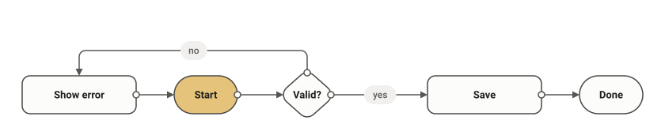
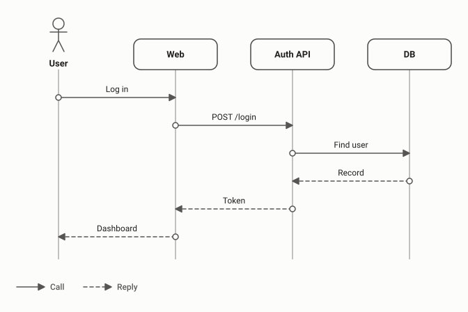
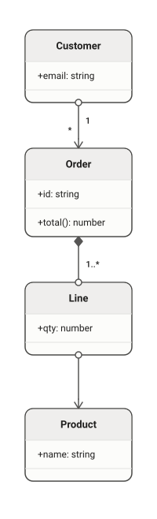
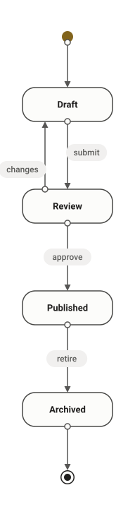
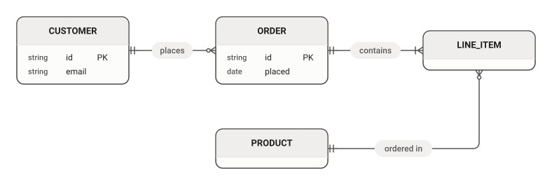
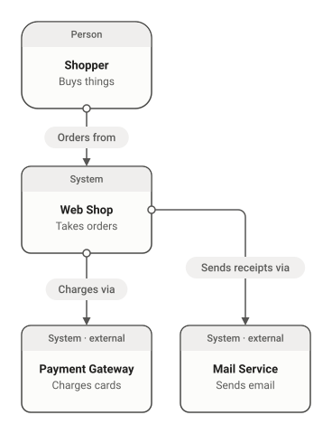

# Examples

Every picture on these pages is the output of `ursula-diagram <file> --format svg`, unedited. This page shows a few at a
glance; the [pages per type](#types) show every example of the Mermaid documentation, with its text beside its picture.

## At a glance

<div class="gallery">
  <figure><figcaption>Flowchart</figcaption><div class="ursula-frame"></div></figure>
  <figure><figcaption>Sequence</figcaption><div class="ursula-frame"></div></figure>
  <figure><figcaption>Class</figcaption><div class="ursula-frame"></div></figure>
  <figure><figcaption>State</figcaption><div class="ursula-frame"></div></figure>
  <figure><figcaption>Entity relationship</figcaption><div class="ursula-frame"></div></figure>
  <figure><figcaption>C4 context</figcaption><div class="ursula-frame"></div></figure>
  <figure class="wide"><figcaption>Mindmap</figcaption><div class="ursula-frame"></div></figure>
  <figure class="wide"><figcaption>Gantt</figcaption><div class="ursula-frame"></div></figure>
</div>

<details>
<summary>The Mermaid text of each picture</summary>

```ursula-input gallery:flowchart
```

```ursula-input gallery:sequence
```

```ursula-input gallery:class
```

```ursula-input gallery:state
```

```ursula-input gallery:er
```

```ursula-input gallery:c4
```

```ursula-input gallery:gantt
```

```ursula-input gallery:mindmap
```

</details>

## By type {#types}

The Mermaid documentation has a page per diagram type. Each page below holds all the code blocks of that page, drawn by
ursula with the text beside the picture. The type is read from the first line of the text, as Mermaid does.

<ExampleTypes />

The example texts are copied from the [Mermaid documentation](https://mermaid.js.org/) under the MIT License; see
[THIRD_PARTY_NOTICES.md](https://github.com/yjun1806/ursula-diagram/blob/main/THIRD_PARTY_NOTICES.md).
