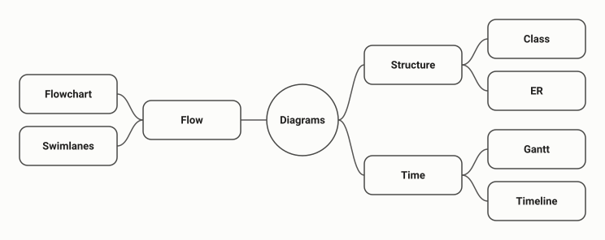
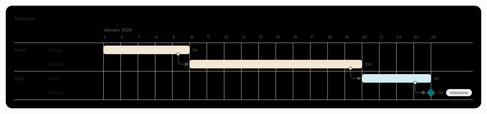

# Examples

Every picture on these pages is the output of `ursula-diagram <file> --format svg`, unedited. This page shows a few at a
glance; the [pages per type](#types) show every example of the Mermaid documentation, with its text beside its picture.

## At a glance

<div class="gallery">
  <figure><figcaption>Flowchart</figcaption><div class="ursula-frame"></div></figure>
  <figure><figcaption>Sequence</figcaption><div class="ursula-frame"></div></figure>
  <figure><figcaption>Class</figcaption><div class="ursula-frame"></div></figure>
  <figure><figcaption>State</figcaption><div class="ursula-frame"></div></figure>
  <figure><figcaption>Entity relationship</figcaption><div class="ursula-frame"></div></figure>
  <figure><figcaption>C4 context</figcaption><div class="ursula-frame"></div></figure>
  <figure class="wide"><figcaption>Mindmap</figcaption><div class="ursula-frame"></div></figure>
  <figure class="wide"><figcaption>Gantt</figcaption><div class="ursula-frame"></div></figure>
</div>

<details>
<summary>The Mermaid text of each picture</summary>

```
flowchart LR
  A([Start]) --> B{Valid?}
  B -->|yes| C[Save]
  B -->|no| D[Show error]
  D --> A
  C --> E([Done])
```

```
sequenceDiagram
  actor U as User
  participant W as Web
  participant A as Auth API
  participant D as DB
  U->>W: Log in
  W->>A: POST /login
  A->>D: Find user
  D-->>A: Record
  A-->>W: Token
  W-->>U: Dashboard
```

```
classDiagram
  class Order {
    +id: string
    +total(): number
  }
  class Line {
    +qty: number
  }
  class Product {
    +name: string
  }
  class Customer {
    +email: string
  }
  Customer "1" --> "*" Order
  Order *-- "1..*" Line
  Line --> Product
```

```
stateDiagram-v2
  [*] --> Draft
  Draft --> Review: submit
  Review --> Draft: changes
  Review --> Published: approve
  Published --> Archived: retire
  Archived --> [*]
```

```
erDiagram
  CUSTOMER ||--o{ ORDER : places
  ORDER ||--|{ LINE_ITEM : contains
  PRODUCT ||--o{ LINE_ITEM : "ordered in"
  CUSTOMER {
    string id PK
    string email
  }
  ORDER {
    string id PK
    date placed
  }
```

```
C4Context
  Person(buyer, "Shopper", "Buys things")
  System(store, "Web Shop", "Takes orders")
  System_Ext(pay, "Payment Gateway", "Charges cards")
  System_Ext(mail, "Mail Service", "Sends email")
  Rel(buyer, store, "Orders from")
  Rel(store, pay, "Charges via")
  Rel(store, mail, "Sends receipts via")
```

```
gantt
  title Release
  dateFormat YYYY-MM-DD
  section Build
  Design   :a1, 2026-01-05, 5d
  Engine   :a2, after a1, 10d
  section Ship
  Docs     :b1, after a2, 4d
  Release  :milestone, after b1, 0d
```

```
mindmap
  root((Diagrams))
    Flow
      Flowchart
      Swimlanes
    Structure
      Class
      ER
    Time
      Gantt
      Timeline
```

</details>

## By type {#types}

The Mermaid documentation has a page per diagram type. Each page below holds all the code blocks of that page, drawn by
ursula with the text beside the picture. The type is read from the first line of the text, as Mermaid does.

<ExampleTypes />

The example texts are copied from the [Mermaid documentation](https://mermaid.js.org/) under the MIT License; see
[THIRD_PARTY_NOTICES.md](https://github.com/yjun1806/ursula-diagram/blob/main/THIRD_PARTY_NOTICES.md).
