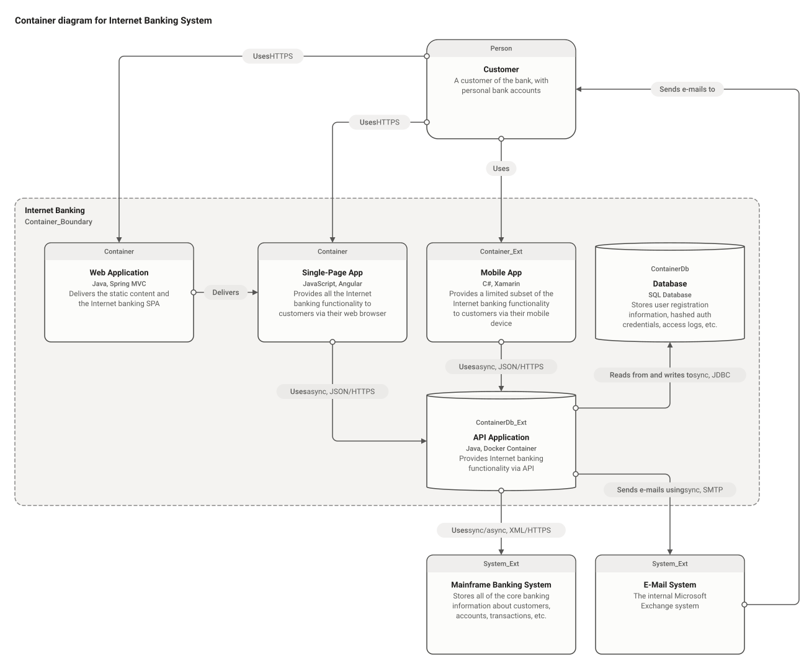
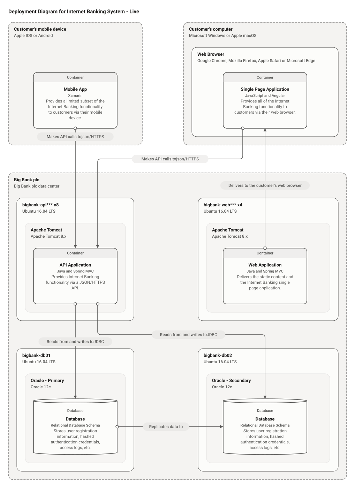

# A larger drawing

Two C4 examples from the Mermaid documentation, drawn as they are. The container diagram has 10 elements, 13
relations and a boundary; people and systems outside the boundary connect to the apps inside it. The deployment
diagram nests nodes three deep (data center, server, Tomcat, application) and ends in a replicated database. Both come
out with no crossings; the report of `--format check` on each is under the pictures.

<p align="center"></p>
<p align="center"></p>

```ursula-output input=file:examples/c4-container.mmd --format check
```

```ursula-output input=file:examples/c4-deployment.mmd --format check
```

The texts are in [examples/c4-container.mmd](https://github.com/yjun1806/ursula-diagram/blob/main/examples/c4-container.mmd) and
[examples/c4-deployment.mmd](https://github.com/yjun1806/ursula-diagram/blob/main/examples/c4-deployment.mmd). The terminal draws them too, but at this size it shortens
long relation labels and draws the boundary as a band, so for drawings like these the SVG reads better.
