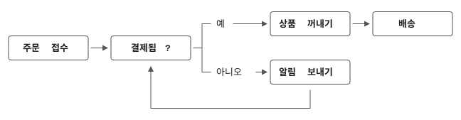

# In a terminal

`--format text` draws with box-drawing characters and arranges the drawing for `--width`. The order flowchart on the
[home page](/) runs left to right at `--width 80`; at `--width 40` the same text comes out stacked top to bottom. A drawing is
never cut off. These are the [gallery](/gallery)'s sequence, Gantt and mindmap texts, drawn with
`ursula-diagram <file> --format text --width 80`.

```
┌───────────────┐   ┌─────┐       ┌───────────┐     ┌─────┐
│ [actor] User  │   │ Web │       │ Auth API  │     │ DB  │
└───────────────┘   └─────┘       └───────────┘     └─────┘
        ├── Log in ───▶┆                ┆              ┆
        ┆              ├─ POST /login ─▶┆              ┆
        ┆              ┆                ├─ Find user ─▶┆
        ┆              ┆                ┆◀┄┄ Record ┄┄┄┤
        ┆              ┆◀┄┄┄┄ Token ┄┄┄┄┤              ┆
        ┆◀┄ Dashboard ┄┤                ┆              ┆

─▶ Call   ┄▶ Reply
```

```
Release
          January 2026
          5  6  7  8  9  10 11 12 13 14 15 16 17 18 19 20 21 22 23 24
──────────┬──┬──┬──┬──┬──┬──┬──┬──┬──┬──┬──┬──┬──┬──┬──┬──┬──┬──┬──
Build
  Design  ███████████████ 5d
  Engine                 ██████████████████████████████ 10d
Ship
  Docs                                                 ████████████ 4d
  Release                                                         ◆ 0d milestone
```

```
Diagrams
├── Flow
│   ├── Flowchart
│   └── Swimlanes
├── Structure
│   ├── Class
│   └── ER
└── Time
    ├── Gantt
    └── Timeline
```

A few types (pie, quadrant, radar, sankey, XY chart, timeline, user journey, railroad, Venn, Cynefin, Wardley) come
out as a table or a list in a terminal, because that is more exact there than a picture:

```
pie title Pets
  "Dogs" : 386
  "Cats" : 85
  "Rats" : 15
```

```
Pets
Dogs  386  79.4%
Cats   85  17.5%
Rats   15   3.1%
```

# When the columns do not line up

A text drawing keeps its columns only where every character is as wide as the engine counts it: one cell for a line
or an arrowhead, two for a Korean, Chinese or Japanese character. A real terminal does that. A chat window, a web
page or a code block in a document often does not, and the boxes come apart. GitHub's code block is one such
place: in Chrome on a Mac it draws a Korean character 1.44 cells wide (measured; it depends on the system and the
font), which is why every text drawing in the README uses Latin letters only.

There are two ways out:

- **`--format text-svg`** draws the same terminal drawing as one SVG. It draws the lines as shapes and sets every
  word on the grid, so no font moves a column. Below, a drawing with Korean labels:

  

- **`--charset ascii`** draws with ASCII characters only, for a terminal that draws box lines two cells wide:

  ```
                                           +------------+   +------------+
                                  +- yes ->| Pick items |-->|    Ship    |
  +------------+   +------------+ |        +------------+   +------------+
  |   Order    |-->|   Paid?    |-+
  |   placed   |   +------------+ |        +------------+
  +------------+          ^       +- no -->|    Send    |
                          |                |  reminder  |
                          |                +------------+
                          |                       |
                          +-----------------------+
  ```

<details>
<summary>Which characters <code>--charset ascii</code> replaces</summary>

| | `unicode` (default) | `ascii` |
| --- | --- | --- |
| Line, heavy line, dashed line | `─ │` `━ ┃` `┄ ┆` | `- \|` `= #` `. :` |
| Corner, tee, crossing; rounded corner | `┌ ├ ┼`; `╭ ╮ ╰ ╯` | `+`; `/ \ \ /` |
| Arrowhead; hollow arrowhead | `▶ ◀ ▼ ▲`; `──▷` | `> < v ^`; `--\|>` |
| Filled and open diamond, dots, bar | `◆ ◇` `● ◉` `█` | `@ o` `* @` `#` |
| Cut-off text | `…` | `~` |

The text of the diagram is kept as written. The characters of the table are replaced wherever they stand, and so
are a few symbols that some terminals draw two cells wide (`·` `×` `—` `∩` `⊕`).

</details>
