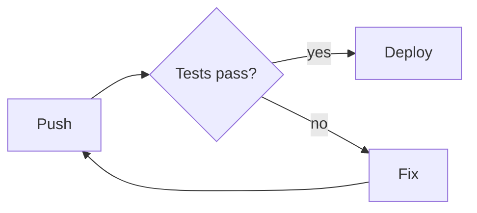

# Ways to use ursula

The same engine draws the same picture as a command, an agent skill, an MCP server, a library for Node and the
browser, and one browser file. Each section below says when to pick a way, gives the smallest snippet that works,
shows what comes out, and links to the page with the details. What each diagram type looks like is on the
[Examples](/examples/) pages.

## In a terminal

Use it when you read the drawing where you work: a shell, a log, a code review in the terminal.



```bash
ursula-diagram flow.mmd --format text
```

What it prints for the text above:

```ursula-output --format text
flowchart LR
  Push --> CI{Tests pass?}
  CI -->|yes| Deploy
  CI -->|no| Fix
  Fix --> Push
```

Widths, errors and exit codes: [In a terminal](/guide/terminal).

## As an agent skill

Use it when a coding agent (Claude Code, Codex, Cursor and others) should draw while it explains. The
[skills](https://skills.sh) command installs the skill into the agent:

```bash
npx skills add yjun1806/ursula-diagram
```

With the skill, the agent:

1. writes Mermaid text, never coordinates;
2. draws it with `--check` and `--fix`, and reads the engine's report and fixes;
3. gives you `text` in a terminal, `text-svg` in a chat, and `svg` or `html` in a file.

Other places to install it and the full loop: [Agent skill](/guide/agent-skill).

## Over MCP

Use it when the agent has no shell, as in Claude Desktop. In Claude Code, one command adds the server:

```bash
claude mcp add ursula -- npx -y ursula-diagram mcp
```

In Claude Desktop, add it to `claude_desktop_config.json`:

```json
{ "mcpServers": { "ursula": { "command": "npx", "args": ["-y", "ursula-diagram", "mcp"] } } }
```

The agent gets three tools, `render`, `check` and `syntax`. `render` returns terminal text, an SVG, an HTML page or a
PNG the client shows as an image. Tools and arguments: [Over MCP](/guide/agent-skill#over-mcp).

## In a Claude Code mod

Use it when every ```` ```mermaid ```` block in Claude Code's replies should show as a drawing, with no skill and no
extra turn. A mod is a plugin that changes how Claude Code draws, here through a `ui.render` hook on each block of a
reply. The module below is an example written for this page, not a published plugin, and the plugin API is in early
access, so its names may change. It runs `ursula-diagram` on each Mermaid block with the text on standard input,
keeps each drawing for the same text and width, and leaves the block as it was when the command is missing or the
text has an error:

```ts [hooks/register.ts]
import type { EngineInterface, Register } from 'claude-code';

// An example, not a published plugin: draws each ```mermaid block of a reply as terminal text.
const MERMAID = /```mermaid\n([\s\S]*?)```/g;
const drawings = new Map<string, string | null>();

async function draw($: EngineInterface, source: string, width: number): Promise<string | null> {
  try {
    const out = await $.process.run(['ursula-diagram', '--format', 'text', '--width', String(width)], { stdin: source });
    return out.exitCode === 0 ? out.stdout : null;
  } catch {
    return null; // ursula-diagram is not installed: keep the Mermaid text
  }
}

export const register: Register = (on) => {
  on('ui.render', { component: 'AssistantMessage' }, async ($, e, next) => {
    const width = Math.max(40, (e.viewport?.columns ?? 100) - 4);
    let text = e.props.text;
    for (const [block, source] of e.props.text.matchAll(MERMAID)) {
      const key = `${width}\n${source}`;
      if (!drawings.has(key)) drawings.set(key, await draw($, source, width));
      const drawing = drawings.get(key);
      if (drawing) text = text.replace(block, () => '```text\n' + drawing + '```');
    }
    return next({ ...e, props: { ...e.props, text } });
  });
};
```

`hooks/hooks.json` names the module with `{ "modules": ["./register.ts"] }`, beside `.claude-plugin/plugin.json`.
The hook leaves out `--color`: a reply's markdown takes no control characters but the newline, so colour codes
would not reach the screen. The reply then shows the drawing of [In a terminal](#in-a-terminal) in place of the
Mermaid text. A host that draws spans itself can colour them with `renderTextSpans`:
[In an agent's terminal](/guide/agent-skill#in-an-agent-s-terminal).

## In a claude.ai artifact or one HTML page

Use it when a page with no build step should draw Mermaid: a claude.ai artifact, a CodePen, a local `.html` file. The
page loads the browser build from jsDelivr, and `ursula.render` returns the SVG. The CSS variables set its colours,
and the SVG switches to its dark values under `prefers-color-scheme: dark`:

```html [index.html]
<!doctype html>
<meta charset="utf-8">
<style>
  :root { --ursula-accent: #0b6e4f; --ursula-start-fill: #bfe3d0; }
  @media (prefers-color-scheme: dark) { :root { --ursula-accent: #6fd3a8; --ursula-start-fill: #1f5a43; } }
</style>
<div id="diagram"></div>
<script src="https://cdn.jsdelivr.net/npm/ursula-diagram@0.2/dist/ursula.global.js"></script>
<script>
  const text = `flowchart LR
  Q[Question] --> M[Claude writes Mermaid]
  M --> R[ursula.render]
  R --> P[SVG on the page]`;
  document.getElementById('diagram').innerHTML = ursula.render(text);
</script>
```

The same text, drawn in this page by the same file:

<ArtifactDemo />

`@0.2` takes the newest release of that minor version. Every colour variable: [Colours](/guide/colours). The
global and what it holds: [In a browser](/guide/library#in-a-browser).

## In a Node script or a build step

Use it when diagrams live as `.mmd` files next to the docs and should become SVG files. This script draws every file
in `diagrams/` into `out/`, as an SVG and as terminal text:

```js [build.mjs]
import { mkdirSync, readFileSync, readdirSync, writeFileSync } from 'node:fs';
import { render, renderText } from 'ursula-diagram';

mkdirSync('out', { recursive: true });
for (const file of readdirSync('diagrams').filter((f) => f.endsWith('.mmd'))) {
  const source = readFileSync(`diagrams/${file}`, 'utf8');
  const name = file.replace(/\.mmd$/, '');
  writeFileSync(`out/${name}.svg`, render(source));
  const text = renderText(source, 100);
  if ('lines' in text) writeFileSync(`out/${name}.txt`, text.lines.join('\n') + '\n');
}
```

A site built with markdown-it, such as VitePress, can draw each ```` ```mermaid ```` block at build time by
replacing the fence rule. The page then holds the SVG and loads no script:

```js [mermaid-fence.mjs]
import { render } from 'ursula-diagram';

export function ursulaMermaid(md) {
  const fence = md.renderer.rules.fence;
  md.renderer.rules.fence = (tokens, idx, options, env, self) => {
    const token = tokens[idx];
    if (token.info.trim() !== 'mermaid') return fence(tokens, idx, options, env, self);
    try {
      return `<div class="diagram">${render(token.content)}</div>`;
    } catch (error) {
      return `<pre>${md.utils.escapeHtml(error.message)}</pre>`;
    }
  };
}
```

In VitePress, pass it in `.vitepress/config.mjs` as `markdown: { config: (md) => md.use(ursulaMermaid) }`. Ready-made
plugins for markdown-it and remark are planned in [#26](https://github.com/yjun1806/ursula-diagram/issues/26).
Every function and its options: [Library](/guide/library).

## In a web app

Use it for a live preview that draws as someone types. `render` measures text with its own tables, not with the
DOM, so it runs the same in a component, a Web Worker or server rendering. A React component:

```jsx [Diagram.jsx]
import { useMemo } from 'react';
import { render } from 'ursula-diagram';

export function Diagram({ text }) {
  const out = useMemo(() => {
    try {
      return { svg: render(text) };
    } catch (error) {
      return { error: error.message };
    }
  }, [text]);
  if (out.error) return <pre>{out.error}</pre>;
  return <div dangerouslySetInnerHTML={{ __html: out.svg }} />;
}
```

In plain JavaScript, call `render` in the `input` event of a text area and set the result as `innerHTML`. The browser
file is 330 kB gzipped, against 1.58 MB for Mermaid.js, and a flowchart takes a median of 0.7 ms
([Why ursula](/guide/why)). The [playground](/playground) is such a page.

## As an image for a chat or a document

Use it where only a picture goes in: a chat message, a slide, an issue. With the optional renderer installed, the
command writes a PNG:

```bash
ursula-diagram flow.mmd --format png --theme light > flow.png
```

The PNG is twice the size of the SVG, in the light or dark colours of `--theme`. Without the command, the
[playground](/playground)'s <b>Copy as image</b> copies the drawing as a PNG in the colours the page shows. Installing
the renderer and fonts: [Output formats](/guide/output-formats).

## Checking diagrams in CI

Use it to stop a broken diagram before it merges. `--format check` prints the engine's report and ends with 1 when
the text has an error:

```bash
ursula-diagram flow.mmd --format check
```

```ursula-output exit=1 --format check
flowchrt LR
  A --> B
```

A GitHub Actions step that checks every `.mmd` file of the repository. The step fails at the first file that does
not draw:

```yaml
- uses: actions/setup-node@v4
  with: { node-version: 22 }
- name: Check Mermaid diagrams
  run: for f in $(git ls-files '*.mmd'); do npx -y ursula-diagram "$f" --format check > /dev/null; done
```

A ready-made GitHub Action is planned in [#27](https://github.com/yjun1806/ursula-diagram/issues/27). The exit codes:
[Errors, the check and exit codes](/guide/terminal#errors-the-check-and-exit-codes).
