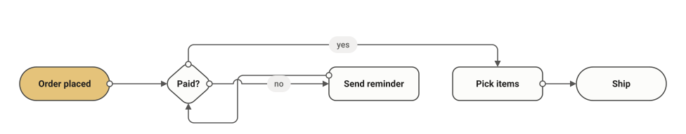

<div class="vp-doc" style="max-width: 1152px; margin: 48px auto 0; padding: 0 24px;">

## What it does

ursula reads the Mermaid text of any of the 35 diagram types in the Mermaid documentation and computes where every
box, line and label goes. It is made for coding agents: the agent writes a few lines of Mermaid, and the engine lays
them out, as an SVG or as a drawing for the agent's terminal, in a median of 0.36 ms. The same text always gives the
same drawing. It runs on Node alone: no browser, no DOM, nothing to install at run time.

```
flowchart LR
  order([Order placed]) --> pay{Paid?}
  pay -->|yes| pick[Pick items]
  pay -->|no| remind[Send reminder]
  remind --> pay
  pick --> ship([Ship])
```

```
                                         ┌────────────┐   ┌────────────┐
                                ┌─ yes ─▶│ Pick items │──▶│    Ship    │
┌────────────┐   ┌────────────┐ │        └────────────┘   └────────────┘
│   Order    │──▶│   Paid?    │─┤
│   placed   │   └────────────┘ │        ┌────────────┐
└────────────┘          ▲       └─ no ──▶│    Send    │
                        │                │  reminder  │
                        │                └────────────┘
                        │                       │
                        └───────────────────────┘
```

<p class="figure"></p>

The first block is the input. The text drawing and the picture under it are what ursula draws from it, with
`--format text --width 80` and with `--format svg`. Try your own text in the [playground](/playground).

</div>
