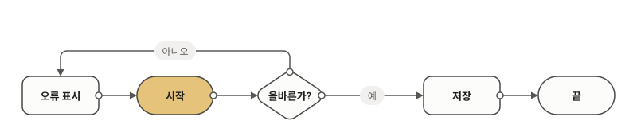
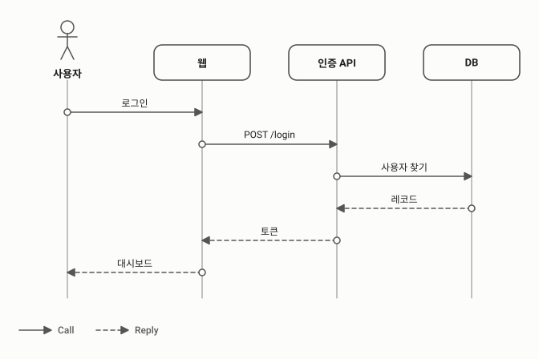
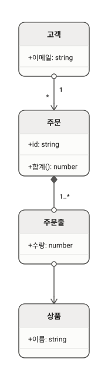
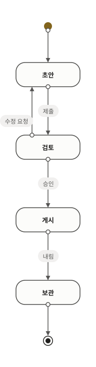
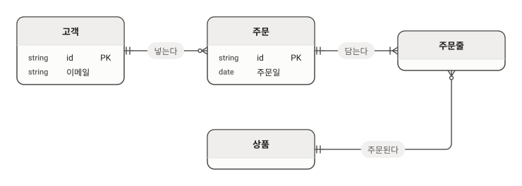
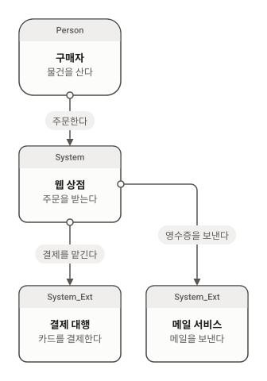
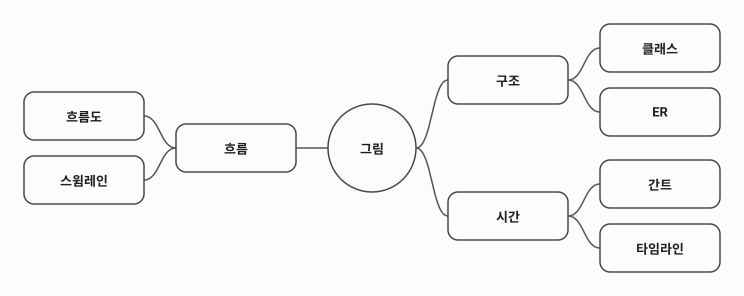
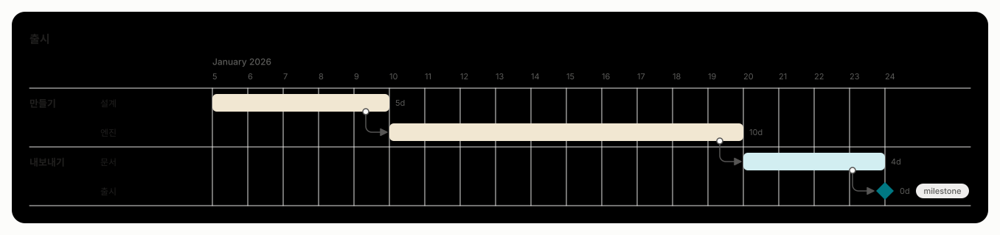

# 예제

예제 페이지의 그림은 모두 `ursula-diagram <파일> --format svg`가 낸 결과를 고치지 않고 실었습니다. 이 페이지에는 몇 장만
골라 모았고, [유형별 페이지](#types)에는 Mermaid 문서의 예시 전부를 글과 그림을 나란히 놓아 실었습니다.

## 한눈에 보기

SVG는 글자를 정해진 좌표에 놓으므로 한글 라벨도 그대로 들어갑니다.

<div class="gallery">
  <figure><figcaption>Flowchart</figcaption><div class="ursula-frame"></div></figure>
  <figure><figcaption>Sequence</figcaption><div class="ursula-frame"></div></figure>
  <figure><figcaption>Class</figcaption><div class="ursula-frame"></div></figure>
  <figure><figcaption>State</figcaption><div class="ursula-frame"></div></figure>
  <figure><figcaption>Entity relationship</figcaption><div class="ursula-frame"></div></figure>
  <figure><figcaption>C4 context</figcaption><div class="ursula-frame"></div></figure>
  <figure class="wide"><figcaption>Mindmap</figcaption><div class="ursula-frame"></div></figure>
  <figure class="wide"><figcaption>Gantt</figcaption><div class="ursula-frame"></div></figure>
</div>

<details>
<summary>그림별 Mermaid 글</summary>

```ursula-input gallery-ko:flowchart
```

```ursula-input gallery-ko:sequence
```

```ursula-input gallery-ko:class
```

```ursula-input gallery-ko:state
```

```ursula-input gallery-ko:er
```

```ursula-input gallery-ko:c4
```

```ursula-input gallery-ko:gantt
```

```ursula-input gallery-ko:mindmap
```

</details>

## 유형별 예시 {#types}

Mermaid 문서에는 다이어그램 유형마다 페이지가 하나씩 있습니다. 아래 유형별 페이지는 그 문서 페이지의 코드 블록을 모두
ursula로 그려 글 옆에 그림을 놓았습니다. ursula는 Mermaid처럼 글의 첫 줄을 보고 유형을 정합니다.

<ExampleTypes />

예시 글은 [Mermaid 문서](https://mermaid.js.org/)에서 MIT 라이선스로 가져왔습니다.
자세한 내용은 [THIRD_PARTY_NOTICES.md](https://github.com/yjun1806/ursula-diagram/blob/main/THIRD_PARTY_NOTICES.md)에 있습니다.
