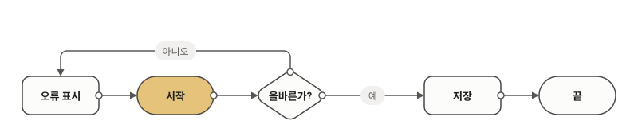
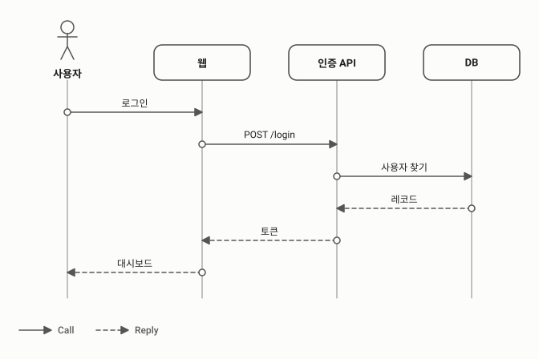
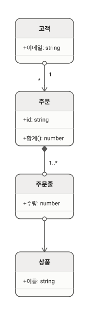
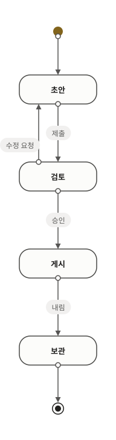
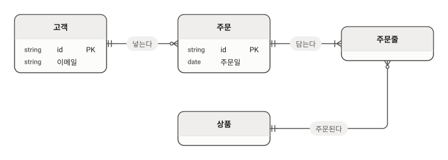
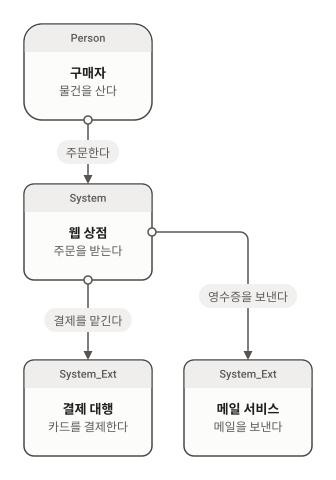
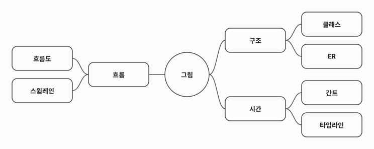
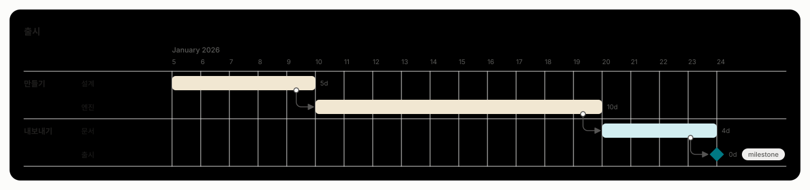

# 그림 모음

아래 그림은 모두 `ursula-diagram <파일> --format svg`가 낸 결과를 고치지 않고 실었습니다. SVG는 글자를 정한 자리에
놓으므로 한글 라벨도 그대로 씁니다.

<div class="gallery">
  <figure><figcaption>흐름도</figcaption><div class="ursula-frame"></div></figure>
  <figure><figcaption>시퀀스</figcaption><div class="ursula-frame"></div></figure>
  <figure><figcaption>클래스</figcaption><div class="ursula-frame"></div></figure>
  <figure><figcaption>상태</figcaption><div class="ursula-frame"></div></figure>
  <figure><figcaption>ER</figcaption><div class="ursula-frame"></div></figure>
  <figure><figcaption>C4 컨텍스트</figcaption><div class="ursula-frame"></div></figure>
  <figure class="wide"><figcaption>마인드맵</figcaption><div class="ursula-frame"></div></figure>
  <figure class="wide"><figcaption>간트</figcaption><div class="ursula-frame"></div></figure>
</div>

<details>
<summary>그림마다의 Mermaid 글</summary>

```
flowchart LR
  A([시작]) --> B{올바른가?}
  B -->|예| C[저장]
  B -->|아니오| D[오류 표시]
  D --> A
  C --> E([끝])
```

```
sequenceDiagram
  actor U as 사용자
  participant W as 웹
  participant A as 인증 API
  participant D as DB
  U->>W: 로그인
  W->>A: POST /login
  A->>D: 사용자 찾기
  D-->>A: 레코드
  A-->>W: 토큰
  W-->>U: 대시보드
```

```
classDiagram
  class 주문 {
    +id: string
    +합계(): number
  }
  class 주문줄 {
    +수량: number
  }
  class 상품 {
    +이름: string
  }
  class 고객 {
    +이메일: string
  }
  고객 "1" --> "*" 주문
  주문 *-- "1..*" 주문줄
  주문줄 --> 상품
```

```
stateDiagram-v2
  [*] --> 초안
  초안 --> 검토: 제출
  검토 --> 초안: 수정 요청
  검토 --> 게시: 승인
  게시 --> 보관: 내림
  보관 --> [*]
```

```
erDiagram
  고객 ||--o{ 주문 : 넣는다
  주문 ||--|{ 주문줄 : 담는다
  상품 ||--o{ 주문줄 : "주문된다"
  고객 {
    string id PK
    string 이메일
  }
  주문 {
    string id PK
    date 주문일
  }
```

```
C4Context
  Person(buyer, "구매자", "물건을 산다")
  System(store, "웹 상점", "주문을 받는다")
  System_Ext(pay, "결제 대행", "카드를 결제한다")
  System_Ext(mail, "메일 서비스", "메일을 보낸다")
  Rel(buyer, store, "주문한다")
  Rel(store, pay, "결제를 맡긴다")
  Rel(store, mail, "영수증을 보낸다")
```

```
gantt
  title 출시
  dateFormat YYYY-MM-DD
  section 만들기
  설계   :a1, 2026-01-05, 5d
  엔진   :a2, after a1, 10d
  section 내보내기
  문서     :b1, after a2, 4d
  출시     :milestone, after b1, 0d
```

```
mindmap
  root((그림))
    흐름
      흐름도
      스윔레인
    구조
      클래스
      ER
    시간
      간트
      타임라인
```

</details>

# 그리는 유형

유형은 Mermaid와 같이 글의 첫 줄에서 읽습니다. 35가지 모두입니다.

Architecture, Block, C4, Class, Cynefin, Entity Relationship, Event Modeling, Flowchart, Gantt, Git Graph, Ishikawa,
Kanban, Mindmap, Packet, Pie, Quadrant, Radar, Railroad(IR, ABNF, EBNF, PEG), Requirement, Sankey, Sequence, State,
Swimlanes, Timeline, TreeView, Treemap, Use Case, User Journey, Venn, Wardley Map, XY Chart, ZenUML.

