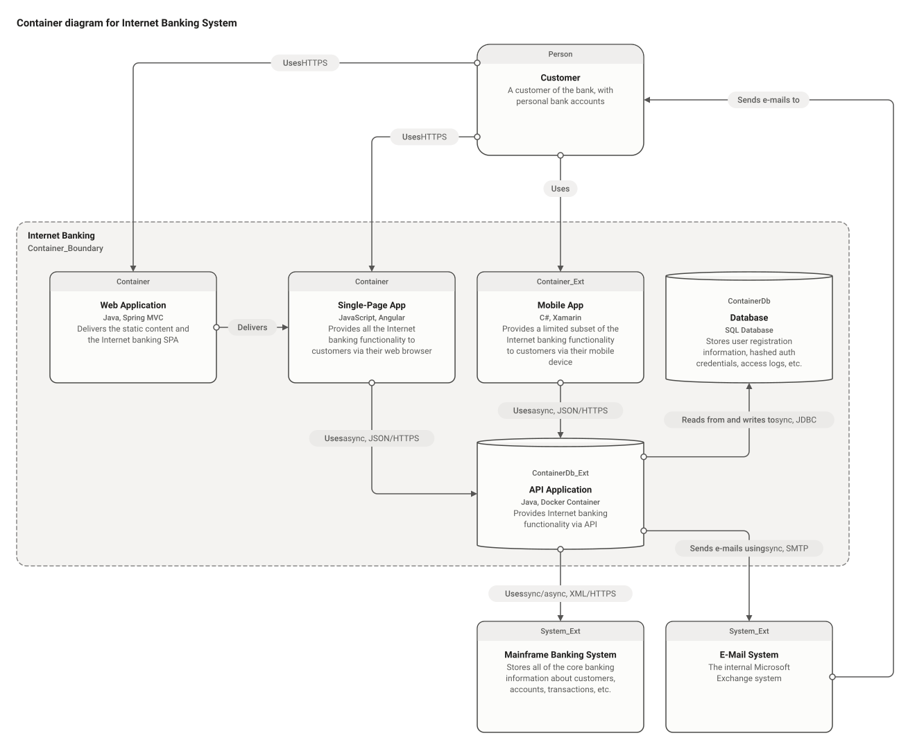
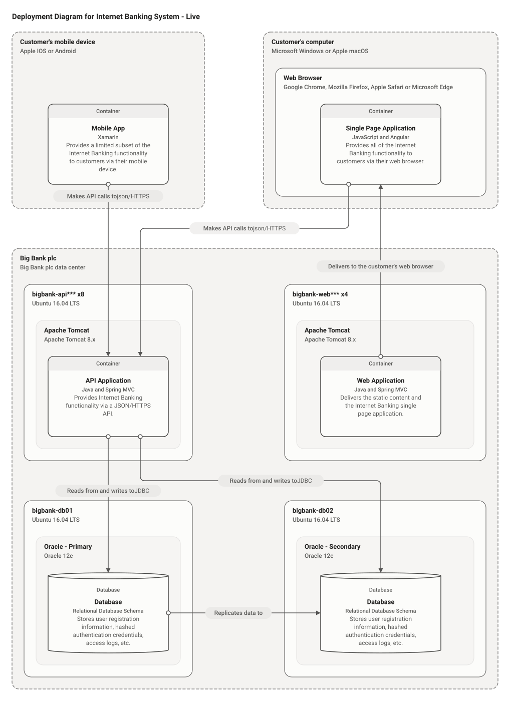

# 큰 그림

아래는 Mermaid 문서에 있는 C4 예시 두 장을 고치지 않고 그린 그림입니다. 컨테이너 그림은 요소 10개, 관계 13개, 경계 하나로
이루어지며, 경계 밖의 사람·시스템이 경계 안의 앱들과 이어집니다. 배포 그림은 노드가 3단까지 겹치고(데이터센터, 서버,
Tomcat, 앱) 복제되는 데이터베이스로 끝납니다. 두 장 모두 교차가 없습니다(`--format check`: 꺾임 7개, 4개).

글은 [examples/c4-container.mmd](https://github.com/yjun1806/ursula-diagram/blob/main/examples/c4-container.mmd)와 [examples/c4-deployment.mmd](https://github.com/yjun1806/ursula-diagram/blob/main/examples/c4-deployment.mmd)에
있습니다. 터미널에서도 그릴 수 있지만, 이 크기에서는 긴 관계 라벨을 줄이고 경계를 띠로 그립니다. 그래서 이런 그림은 SVG가
더 잘 읽힙니다.

