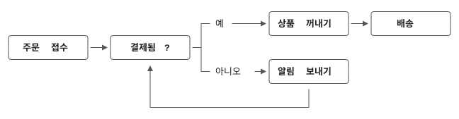

# 터미널에서

`--format text`는 상자 그리기 글자로 그리고, `--width`에 맞춰 그림을 배치합니다. [첫 화면](/ko/)의 주문 flowchart는
`--width 80`에서 왼쪽에서 오른쪽으로 놓이고, `--width 40`에서는 같은 글이 위에서 아래로 쌓입니다. 그림을 잘라 내지는
않습니다. 아래는 [예제](/ko/examples/) 페이지의 sequence·Gantt·mindmap을 영문 라벨로 바꿔 쓴 글을
`ursula-diagram <파일> --format text --width 80`으로 그린 결과입니다.

```
╭───────────────╮   ╭─────╮       ╭───────────╮     ╭─────╮
│ [actor] User  │   │ Web │       │ Auth API  │     │ DB  │
╰───────────────╯   ╰─────╯       ╰───────────╯     ╰─────╯
        ├── Log in ───▶┆                ┆              ┆
        ┆              ├─ POST /login ─▶┆              ┆
        ┆              ┆                ├─ Find user ─▶┆
        ┆              ┆                ┆◀┄┄ Record ┄┄┄┤
        ┆              ┆◀┄┄┄┄ Token ┄┄┄┄┤              ┆
        ┆◀┄ Dashboard ┄┤                ┆              ┆

─▶ Call   ┄▶ Reply
```

```
Release
          January 2026
          5  6  7  8  9  10 11 12 13 14 15 16 17 18 19 20 21 22 23 24
──────────┬──┬──┬──┬──┬──┬──┬──┬──┬──┬──┬──┬──┬──┬──┬──┬──┬──┬──┬──
Build
  Design  ███████████████ 5d
  Engine                 ██████████████████████████████ 10d
Ship
  Docs                                                 ████████████ 4d
  Release                                                         ◆ 0d milestone
```

```
Diagrams
├── Flow
│   ├── Flowchart
│   └── Swimlanes
├── Structure
│   ├── Class
│   └── ER
└── Time
    ├── Gantt
    └── Timeline
```

몇몇 유형(pie, quadrant, radar, sankey, XY chart, timeline, user journey, railroad, Venn, Cynefin, Wardley)은
터미널에서 표나 목록으로 나옵니다. 터미널에서는 그림보다 표나 목록이 더 정확하기 때문입니다.

```
pie title Pets
  "Dogs" : 386
  "Cats" : 85
  "Rats" : 15
```

```
Pets
Dogs  386  79.4%
Cats   85  17.5%
Rats   15   3.1%
```

# 줄이 맞지 않을 때

글자 그림은 모든 글자가 엔진이 센 폭대로 그려질 때만 줄이 맞습니다. 엔진은 선과 화살촉을 한 칸으로, 한글·한자·가나를
두 칸으로 셉니다. 실제 터미널은 이렇게 그립니다. 채팅 창, 웹 페이지, 문서의 코드 블록은 그렇지 않은 경우가 많아 상자가
어긋납니다. 예를 들어 맥의 크롬에서 GitHub 코드 블록은 한글 한 글자를 영문 1.44칸 폭으로 그립니다(직접 잰 값이며 운영체제와 글꼴에 따라 다릅니다). 그래서 README의 글자 그림은
영문으로만 적었습니다.

이럴 때는 두 가지 방법을 씁니다.

- **`--format text-svg`** 는 같은 글자 그림을 SVG 한 장으로 그립니다. 선을 도형으로 그리고 모든 낱말을 칸 자리에 고정하므로,
  어떤 글꼴로 보여도 줄이 어긋나지 않습니다. 아래는 한글 라벨이 든 그림입니다.

  

- **`--charset ascii`** 는 ASCII 글자만으로 그립니다. 상자 선 글자를 두 칸으로 그리는 터미널에서 씁니다.

  ```
                                           +------------+   +------------+
                                  +- yes ->| Pick items |-->|    Ship    |
  +------------+   +------------+ |        +------------+   +------------+
  |   Order    |-->|   Paid?    |-+
  |   placed   |   +------------+ |        +------------+
  +------------+          ^       +- no -->|    Send    |
                          |                |  reminder  |
                          |                +------------+
                          |                       |
                          +-----------------------+
  ```

<details>
<summary><code>--charset ascii</code>가 바꾸는 글자</summary>

| | `unicode`(기본) | `ascii` |
| --- | --- | --- |
| 선, 굵은 선, 점선 | `─ │` `━ ┃` `┄ ┆` | `- \|` `= #` `. :` |
| 상자·선의 모서리, 갈림, 교차 | `╭ ┌ ├ ┼` | `+` |
| git 가지·kanban 카드·block 모양의 둥근 꺾임 | `╭ ╮ ╰ ╯` | `/ \ \ /` |
| 화살촉, 속 빈 화살촉 | `▶ ◀ ▼ ▲`, `──▷` | `> < v ^`, `--\|>` |
| 채운·빈 마름모, 점, 막대 | `◆ ◇` `● ◉` `█` | `@ o` `* @` `#` |
| 잘린 글 | `…` | `~` |

그림 안의 글은 적은 그대로 둡니다. 다만 엔진은 위 표의 글자가 글 안에 있어도 바꾸고, 일부 터미널이 두 칸으로 그리는
기호 몇 개(`·` `×` `—` `∩` `⊕`)도 바꿉니다.

</details>

