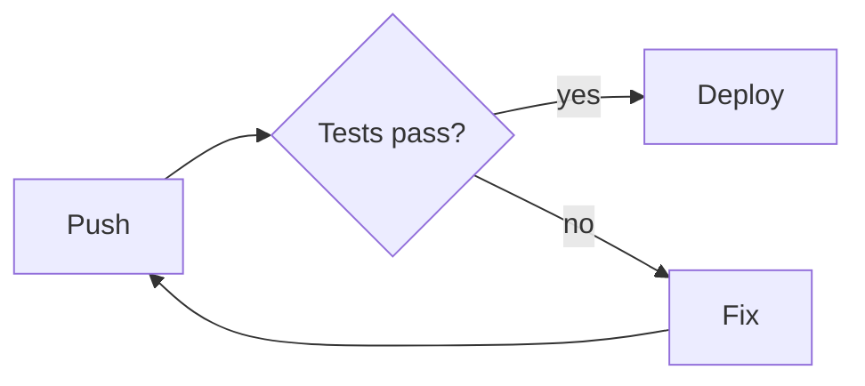

# ursula를 쓰는 방법

같은 엔진이 명령, 에이전트 스킬, MCP 서버, Node와 브라우저용 라이브러리, 브라우저 파일 하나로 같은 그림을 그립니다.
아래 각 절은 언제 그 방법을 고르는지, 돌아가는 가장 작은 코드, 나오는 결과, 자세한 페이지의 링크를 차례로 적습니다.
다이어그램 타입별 모양은 [예제](/ko/examples/) 페이지에 있습니다.

## 터미널에서

셸, 로그, 터미널 속 코드 리뷰처럼 일하는 자리에서 그림을 읽을 때 씁니다.



```bash
ursula-diagram flow.mmd --format text
```

위 글을 그리면 이렇게 나옵니다.

```ursula-output --format text
flowchart LR
  Push --> CI{Tests pass?}
  CI -->|yes| Deploy
  CI -->|no| Fix
  Fix --> Push
```

너비, 오류, 종료 코드는 [터미널에서](/ko/guide/terminal)에 있습니다.

## 에이전트 스킬로

Claude Code, Codex, Cursor 같은 코딩 에이전트가 설명하면서 그림을 그리게 할 때 씁니다.
[skills](https://skills.sh) 명령이 에이전트에 스킬을 설치합니다.

```bash
npx skills add yjun1806/ursula-diagram
```

스킬을 쓰면 에이전트는 다음처럼 움직입니다.

1. 좌표 없이 Mermaid 글만 씁니다.
2. `--check`와 `--fix`를 붙여 그리고, 엔진의 점검 결과와 고친 곳을 읽습니다.
3. 터미널에는 `text`, 채팅에는 `text-svg`, 파일에는 `svg`나 `html`을 줍니다.

다른 설치 위치와 전체 흐름은 [에이전트 스킬](/ko/guide/agent-skill)에 있습니다.

## MCP로

Claude Desktop처럼 에이전트에게 셸이 없을 때 씁니다. Claude Code에서는 명령 하나로 서버를 더합니다.

```bash
claude mcp add ursula -- npx -y ursula-diagram mcp
```

Claude Desktop에서는 `claude_desktop_config.json`에 더합니다.

```json
{ "mcpServers": { "ursula": { "command": "npx", "args": ["-y", "ursula-diagram", "mcp"] } } }
```

에이전트는 `render`, `check`, `syntax` 세 도구를 받습니다. `render`는 터미널 글자 그림, SVG, HTML 페이지, 또는
클라이언트가 이미지로 보여 주는 PNG를 돌려줍니다. 도구와 인자는 [MCP로](/ko/guide/agent-skill#mcp로)에 있습니다.

## Claude Code 모드에서

Claude Code 답변의 ```` ```mermaid ```` 블록을 스킬도 추가 턴도 없이 그림으로 보이게 할 때 씁니다. 모드는 Claude
Code가 화면을 그리는 방식을 바꾸는 플러그인이고, 여기서는 답변 블록마다 `ui.render` 훅을 겁니다. 아래 모듈은 이
페이지를 위해 쓴 예시이고 배포한 플러그인이 아닙니다. 플러그인 API는 얼리 액세스여서 이름이 바뀔 수 있습니다. 이
모듈은 Mermaid 블록마다 글을 표준 입력으로 넘겨 `ursula-diagram`을 돌립니다. 같은 글과 너비의 그림은 다시 그리지
않고, 명령이 없거나 글에 오류가 있으면 블록을 그대로 둡니다.

```ts [hooks/register.ts]
import type { EngineInterface, Register } from 'claude-code';

// An example, not a published plugin: draws each ```mermaid block of a reply as terminal text.
const MERMAID = /```mermaid\n([\s\S]*?)```/g;
const drawings = new Map<string, string | null>();

async function draw($: EngineInterface, source: string, width: number): Promise<string | null> {
  try {
    const out = await $.process.run(['ursula-diagram', '--format', 'text', '--width', String(width)], { stdin: source });
    return out.exitCode === 0 ? out.stdout : null;
  } catch {
    return null; // ursula-diagram is not installed: keep the Mermaid text
  }
}

export const register: Register = (on) => {
  on('ui.render', { component: 'AssistantMessage' }, async ($, e, next) => {
    const width = Math.max(40, (e.viewport?.columns ?? 100) - 4);
    let text = e.props.text;
    for (const [block, source] of e.props.text.matchAll(MERMAID)) {
      const key = `${width}\n${source}`;
      if (!drawings.has(key)) drawings.set(key, await draw($, source, width));
      const drawing = drawings.get(key);
      if (drawing) text = text.replace(block, () => '```text\n' + drawing + '```');
    }
    return next({ ...e, props: { ...e.props, text } });
  });
};
```

`hooks/hooks.json`은 `{ "modules": ["./register.ts"] }`로 모듈을 가리키고, 옆에 `.claude-plugin/plugin.json`을 둡니다.
훅은 `--color`를 붙이지 않습니다. 답변의 markdown은 줄바꿈 말고는 제어 문자를 받지 않아서 색 코드가 화면에 닿지 않기
때문입니다. 답변에는 Mermaid 글 대신 [터미널에서](#터미널에서)의 그림이 나옵니다. 조각을 직접 그리는 호스트는
`renderTextSpans`로 색을 입힐 수 있습니다. [에이전트 터미널에서](/ko/guide/agent-skill#에이전트-터미널에서)를 보세요.

## claude.ai 아티팩트나 HTML 페이지 하나에서

빌드 단계 없는 페이지에서 Mermaid를 그릴 때 씁니다. claude.ai 아티팩트, CodePen, 로컬 `.html` 파일이 그렇습니다.
페이지는 jsDelivr에서 브라우저 빌드를 불러오고, `ursula.render`가 SVG를 돌려줍니다. CSS 변수가 색을 정하고, SVG는
`prefers-color-scheme: dark`에서 어두운 값으로 바뀝니다.

```html [index.html]
<!doctype html>
<meta charset="utf-8">
<style>
  :root { --ursula-accent: #0b6e4f; --ursula-start-fill: #bfe3d0; }
  @media (prefers-color-scheme: dark) { :root { --ursula-accent: #6fd3a8; --ursula-start-fill: #1f5a43; } }
</style>
<div id="diagram"></div>
<script src="https://cdn.jsdelivr.net/npm/ursula-diagram@0.2/dist/ursula.global.js"></script>
<script>
  const text = `flowchart LR
  Q[Question] --> M[Claude writes Mermaid]
  M --> R[ursula.render]
  R --> P[SVG on the page]`;
  document.getElementById('diagram').innerHTML = ursula.render(text);
</script>
```

같은 글을 같은 파일로 이 페이지에서 그린 결과입니다.

<ArtifactDemo />

`@0.2`는 그 마이너 버전의 가장 새 릴리스를 받습니다. 색 변수 전체는 [색 바꾸기](/ko/guide/colours)에, 전역 객체와
그 안의 함수는 [브라우저에서](/ko/guide/library#브라우저에서)에 있습니다.

## Node 스크립트나 빌드 단계에서

다이어그램을 문서 옆에 `.mmd` 파일로 두고 SVG 파일로 만들 때 씁니다. 이 스크립트는 `diagrams/`의 파일을 모두
`out/`에 SVG와 터미널 글자 그림으로 그립니다.

```js [build.mjs]
import { mkdirSync, readFileSync, readdirSync, writeFileSync } from 'node:fs';
import { render, renderText } from 'ursula-diagram';

mkdirSync('out', { recursive: true });
for (const file of readdirSync('diagrams').filter((f) => f.endsWith('.mmd'))) {
  const source = readFileSync(`diagrams/${file}`, 'utf8');
  const name = file.replace(/\.mmd$/, '');
  writeFileSync(`out/${name}.svg`, render(source));
  const text = renderText(source, 100);
  if ('lines' in text) writeFileSync(`out/${name}.txt`, text.lines.join('\n') + '\n');
}
```

VitePress처럼 markdown-it으로 만드는 사이트는 fence 규칙을 바꿔 ```` ```mermaid ```` 블록을 빌드할 때 그릴 수
있습니다. 그러면 페이지에는 SVG가 들어가고 스크립트는 하나도 불러오지 않습니다.

```js [mermaid-fence.mjs]
import { render } from 'ursula-diagram';

export function ursulaMermaid(md) {
  const fence = md.renderer.rules.fence;
  md.renderer.rules.fence = (tokens, idx, options, env, self) => {
    const token = tokens[idx];
    if (token.info.trim() !== 'mermaid') return fence(tokens, idx, options, env, self);
    try {
      return `<div class="diagram">${render(token.content)}</div>`;
    } catch (error) {
      return `<pre>${md.utils.escapeHtml(error.message)}</pre>`;
    }
  };
}
```

VitePress에서는 `.vitepress/config.mjs`에 `markdown: { config: (md) => md.use(ursulaMermaid) }`로 넘깁니다.
markdown-it과 remark용 플러그인은 [#26](https://github.com/yjun1806/ursula-diagram/issues/26)에서 계획하고 있습니다.
함수와 옵션 전체는 [라이브러리](/ko/guide/library)에 있습니다.

## 웹 앱에서

입력하는 대로 그리는 미리보기에 씁니다. `render`는 글자 너비를 DOM이 아니라 자체 표로 재므로, 컴포넌트에서도 Web
Worker에서도 서버 렌더링에서도 똑같이 돌아갑니다. React 컴포넌트입니다.

```jsx [Diagram.jsx]
import { useMemo } from 'react';
import { render } from 'ursula-diagram';

export function Diagram({ text }) {
  const out = useMemo(() => {
    try {
      return { svg: render(text) };
    } catch (error) {
      return { error: error.message };
    }
  }, [text]);
  if (out.error) return <pre>{out.error}</pre>;
  return <div dangerouslySetInnerHTML={{ __html: out.svg }} />;
}
```

React 없이 쓸 때는 텍스트 영역의 `input` 이벤트에서 `render`를 부르고 결과를 `innerHTML`에 넣습니다. 브라우저 파일은
gzip으로 330 kB이고 Mermaid.js는 1.58 MB입니다. flowchart 하나는 중앙값 0.7 ms에 그립니다([왜 ursula인가](/ko/guide/why)).
[플레이그라운드](/ko/playground)가 이렇게 만든 페이지입니다.

## 채팅이나 문서에 넣을 이미지로

채팅 메시지, 슬라이드, 이슈처럼 그림만 들어가는 곳에 씁니다. 선택 렌더러를 설치하면 명령이 PNG를 씁니다.

```bash
ursula-diagram flow.mmd --format png --theme light > flow.png
```

PNG는 SVG의 두 배 크기이고, `--theme`의 밝은 색이나 어두운 색으로 그립니다. 명령 없이도
[플레이그라운드](/ko/playground)의 <b>이미지로 복사</b>가 지금 페이지의 색 그대로 PNG를 복사합니다. 렌더러와 글꼴 설치는
[출력 형식](/ko/guide/output-formats)에 있습니다.

## CI에서 다이어그램 점검하기

깨진 다이어그램이 병합되기 전에 막을 때 씁니다. `--format check`는 엔진의 점검 결과를 출력하고, 글에 오류가 있으면
1로 끝납니다.

```bash
ursula-diagram flow.mmd --format check
```

```ursula-output exit=1 --format check
flowchrt LR
  A --> B
```

저장소의 `.mmd` 파일을 모두 점검하는 GitHub Actions 단계입니다. 그려지지 않는 첫 파일에서 단계가 실패합니다.

```yaml
- uses: actions/setup-node@v4
  with: { node-version: 22 }
- name: Check Mermaid diagrams
  run: for f in $(git ls-files '*.mmd'); do npx -y ursula-diagram "$f" --format check > /dev/null; done
```

바로 쓰는 GitHub Action은 [#27](https://github.com/yjun1806/ursula-diagram/issues/27)에서 계획하고 있습니다. 종료 코드는
[오류, 점검, 종료 코드](/ko/guide/terminal#오류-점검-종료-코드)에 있습니다.
