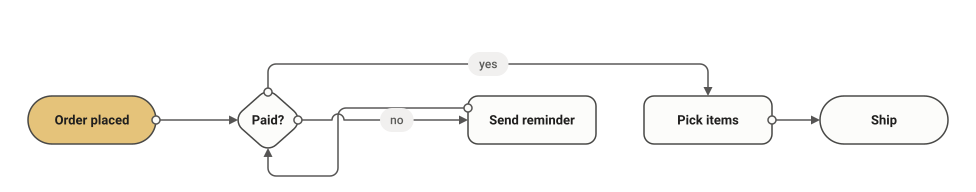

<div class="vp-doc" style="max-width: 1152px; margin: 48px auto 0; padding: 0 24px;">

## 하는 일

ursula는 Mermaid 문서에 있는 유형 35가지의 글을 읽고, 상자·선·라벨의 자리를 직접 계산합니다. 코딩 에이전트를 위해
만들었습니다. 에이전트가 Mermaid 글 몇 줄을 쓰면 엔진이 배치를 계산해 SVG나 에이전트 터미널용 글자 그림으로 그립니다.
SVG 한 장에 드는 시간은 중앙값 0.36ms입니다. 같은 글은 언제나 같은 그림이 됩니다. Node만 있으면 돌고, 브라우저나
DOM이 필요 없으며, 실행할 때 설치할 것도 없습니다.

```
flowchart LR
  order([Order placed]) --> pay{Paid?}
  pay -->|yes| pick[Pick items]
  pay -->|no| remind[Send reminder]
  remind --> pay
  pick --> ship([Ship])
```

```
                                         ┌────────────┐   ┌────────────┐
                                ┌─ yes ─▶│ Pick items │──▶│    Ship    │
┌────────────┐   ┌────────────┐ │        └────────────┘   └────────────┘
│   Order    │──▶│   Paid?    │─┤
│   placed   │   └────────────┘ │        ┌────────────┐
└────────────┘          ▲       └─ no ──▶│    Send    │
                        │                │  reminder  │
                        │                └────────────┘
                        │                       │
                        └───────────────────────┘
```

<p class="figure"></p>

첫 블록이 입력입니다. 그 아래 글자 그림과 그림은 ursula가 같은 글에서 그린 결과로, 각각 `--format text --width 80`과
`--format svg`로 그렸습니다. 이 문서의 글자 그림은 모두 영문입니다. 까닭은 [줄이 맞지 않을 때](/ko/guide/terminal#줄이-맞지-않을-때)에
적었습니다. 직접 쓴 글은 [플레이그라운드](/ko/playground)에서 그려 볼 수 있습니다.

</div>
